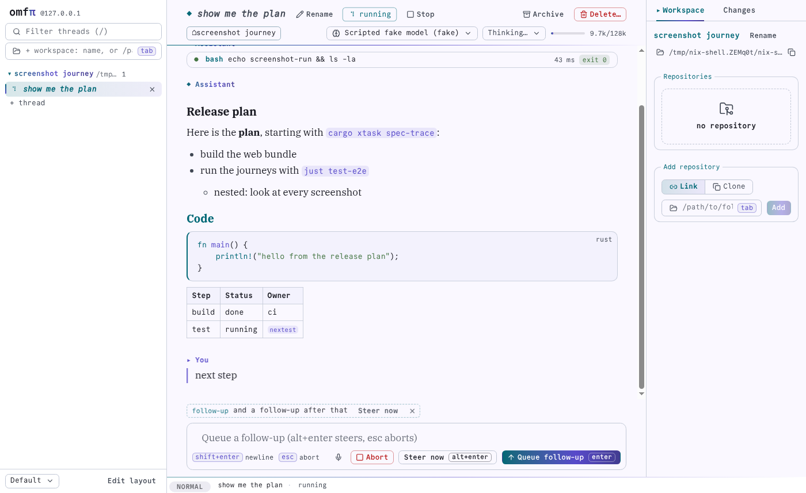

<!-- markdownlint-disable MD033 MD041 -->
<h1>
  <picture>
    <source media="(prefers-color-scheme: dark)" srcset="docs/brand/wordmark-dark.svg">
    
  </picture>
</h1>

**The agent multiplexer for hackers who are tired of prepackaged workflows.**

- **Many [omp](https://github.com/can1357/oh-my-pi) sessions, one place.** Every thread is its own agent. Control them
  from different devices.
- **Persistent workspaces.** A folder of repos and worktrees, shared by as many threads as you want.
- **The agent can rewrite the UI.** Views are trees of React widgets: ask for whatever you want, or let the agent
  propose it. The default view is just as hackable.
- **Almost no opinions.** A small core, a keyboard-driven shell, and the rest is widgets you can copy, replace or throw
  away.
- **Emacs at heart.** You shape the tool from inside it, while it runs.

<picture>
  <source media="(prefers-color-scheme: dark)" srcset="docs/brand/screenshot-dark.png">
  
</picture>

This README is for humans. The slop lives in [docs/overview.md](docs/overview.md). Anything else: ask your agent how
omfp works.\*

\* OK, this one is AI-generated too, but at least I read it.
