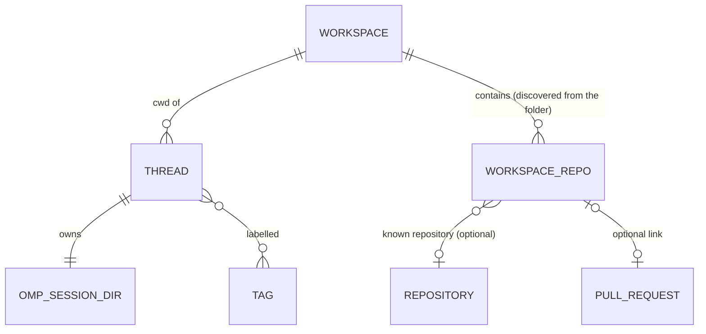
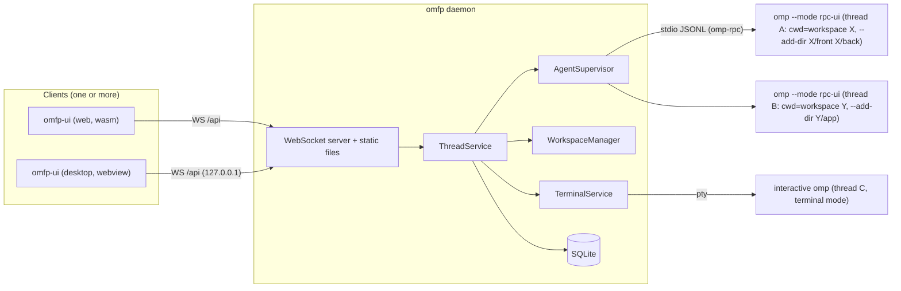
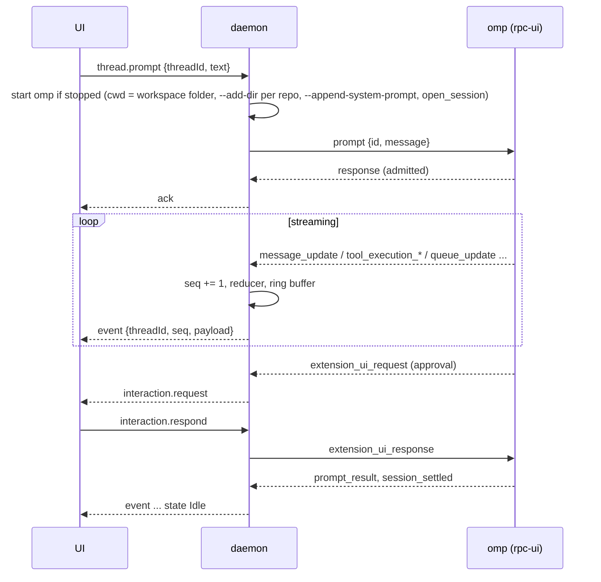

# 00 — Overview and architecture

## Goal

An application for working with many omp agents in parallel:

- **threads** are conversations with an omp agent; each thread lives in one **workspace**, and several threads may
  share it;
- a **workspace** is a folder the agent works in (its cwd); its **repositories** are its top-level entries — clones,
  git worktrees, or links to projects elsewhere — so one thread can span several repositories (e.g. a frontend PR and a
  backend PR); the agent adds or removes repos itself and the UI always shows them (D-11);
- **known repositories** are an optional list that makes adding repos to a workspace quick;
- conversations stream live, with readable tool cards, approvals, agent questions, the message queue, subagents and the
  session tree;
- the same interface runs **in the browser** (wasm) and **as a desktop app** (webview), connected to the same daemon;
- anything the UI does not cover could later be reached from a **terminal panel** on the same session (deferred, D-06);
- long term, **agents drive the interface**: they spawn threads, create workspaces and publish views. This is the last
  milestone, but every earlier choice must keep it possible ([08](08-agent-control.md)).

## Non-goals (for now)

- Rewriting the omp TUI: TUI-only features are out of scope; a terminal handoff is designed but deferred (D-06).
- A full code editor: we show diffs and files; editing happens in the user's editor ("open in editor").
- Multi-user accounts and permissions. The daemon is personal (one OS user), protected by a token.
- Agent control features (08) before the base is solid; only their constraints apply now.
- Packaging and distribution (Nix derivations, installers): out of scope for this phase.

## Domain model



| Entity | Meaning |
| --- | --- |
| Workspace | A folder: created by the daemon under the workspaces root, or an existing folder. The cwd of its threads. |
| Workspace repo | A git repository among the workspace's top-level entries: a `link` (symlink to a project elsewhere), a `worktree` (linked worktree of another repository) or a `clone`; or the folder itself when it is a repository. Not stored: discovered by scanning the folder. |
| Repository | A known git repo (path, default base ref, remote): a shortcut for linking it or creating worktrees of it. |
| Thread | One omp session (its own session directory) in one workspace, title, tags, model settings, provenance. |
| Tag | Free-form label for grouping threads in the UI (e.g. a feature name spanning several PRs). |

## Components



| ID | Requirement |
| --- | --- |
| ARC-001 | The daemon (`omfp daemon`) MUST be the only process that launches omp and speaks the RPC protocol. |
| ARC-002 | The UI MUST communicate only with the daemon, through the protocol in [03](03-protocol.md), on both web and desktop. |
| ARC-003 | `omfp desktop` MUST connect to the local daemon for its data directory when one is running (DMN-007), otherwise start one in the background (`127.0.0.1`, random port) and connect to it; the UI connects like a web client (D-15, D-16). |
| ARC-004 | Several clients MUST be able to connect to the same daemon at once and see the same state. |
| ARC-005 | Each thread MUST have at most one live omp process at a time (RPC or terminal, never both). |
| ARC-006 | A thread's visible state MUST derive from the `omfp-core` reducer applied to its event sequence; daemon and UI run the same code. |
| ARC-007 | **API-first** (D-12): every action available in the UI MUST be a protocol method; the UI holds no business logic that another client could not reproduce through the protocol. |
| ARC-008 | Threads MUST NOT be bound to a single repository: a thread lives in a workspace folder that holds zero or more repositories, and repositories can be added to and removed from the workspace during the thread's life, by the user or by the agent (D-11). |
| ARC-009 | Every created entity (thread, workspace, view) MUST record its provenance: `user` or the id of the thread whose agent created it (needed by 08). |

## Cargo workspace

```text
crates/
  omfp-protocol/   UI↔daemon protocol types (serde). Compiles to wasm.
  omfp-core/       Domain model and pure reducer over omp events. Compiles to wasm. No I/O.
  omfp-daemon/     Daemon library (tokio, axum, rusqlite, omp-rpc, portable-pty): `omfp_daemon::start`, `omfp_daemon::run`.
  omfp-ui/         The app: Dioxus UI (`web` and `desktop` features) and the single `omfp` binary (D-15).
  fake-llm/       Scripted OpenAI-compatible server for tests (lib + bin).
  omfp-testkit/    Test helpers: temporary git repos, isolated omp agent dir, test daemon.
e2e/              End-to-end tests (WebDriver) against the web build.
```

| ID | Requirement |
| --- | --- |
| ARC-010 | `omfp-protocol` and `omfp-core` MUST compile for `wasm32-unknown-unknown` and MUST NOT use tokio, `std::process` or the filesystem. |
| ARC-011 | `omfp-core` MUST reuse `omp_rpc::wire` types for omp events and messages instead of redefining them. The whole `omp-rpc` crate compiles for wasm (S-01), but `omfp-core` and the UI use only its `wire` module; its process client is for the daemon. |
| ARC-012 | System dependencies (git, omp, PTY, clock, ID generation) MUST sit behind traits ("ports") in `omfp-daemon`, so component tests can use fake implementations. |

## Main flow: one prompt



## On-disk data

```text
$XDG_DATA_HOME/omfp/            (default ~/.local/share/omfp)
  omfp.db                        SQLite: repositories, workspaces, threads, tags, settings
  token                         access token (mode 0600)
  threads/<thread-id>/sessions/ sessionDir passed to omp (open_session)
  threads/<thread-id>/omp.log   omp stderr

~/omfp/workspaces/<slug>/        workspaces created by the daemon (--workspaces-root); repos are top-level entries
```

| ID | Requirement |
| --- | --- |
| ARC-020 | A thread's omp sessions MUST live in a dedicated directory opened with `open_session { sessionDir }`, so the thread resumes its session after a process restart, independent of which workspaces it uses. |
| ARC-021 | The user's global omp configuration (`~/.omp/agent`: credentials, models, settings) MUST remain what agents use. The daemon does not modify it. |
