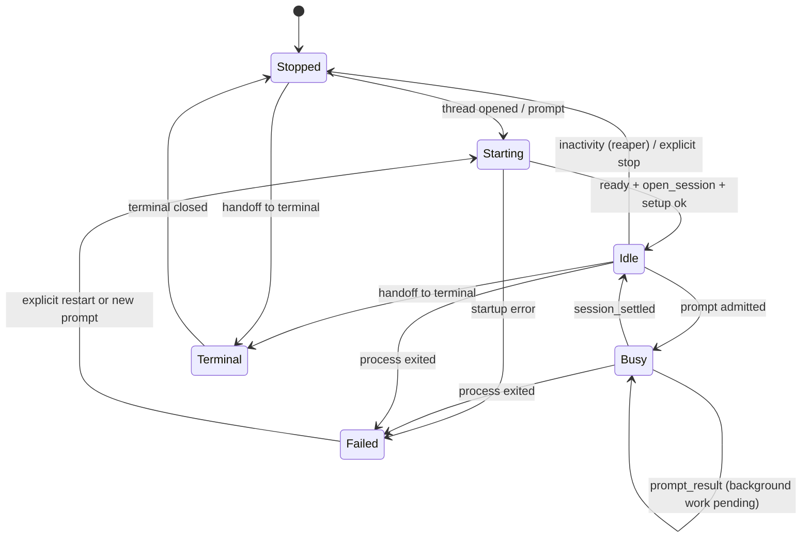

# 02 — Daemon (`omfp daemon`)

The daemon owns repositories, workspaces, threads and omp processes. It serves the protocol in [03](03-protocol.md) and, in web
mode, the UI's static files.

## Startup and configuration

```text
omfp daemon [--bind 127.0.0.1:7420] [--data-dir DIR] [--omp-bin PATH] [--static-dir DIR] [--allow-omp-mismatch]
            [--theme-file PATH] [--no-title-generation] [--config FILE]
```

| ID | Requirement |
| --- | --- |
| DMN-001 | On startup the daemon MUST run `omp --version` and compare it with `omfp_core::OMP_VERSION` (the version of the `omp-rpc` tag, see [01](01-dev-environment.md)). On mismatch it MUST refuse to start unless `--allow-omp-mismatch` is given, in which case a warning is also shown in the UI. |
| DMN-002 | The default `--bind` MUST be `127.0.0.1:7420`; any address and port MAY be configured. Exposure beyond the machine (tunnels, reverse proxies, TLS) is the deployer's job (D-13). |
| DMN-003 | On first run the daemon MUST generate a random token (≥ 256 bits) in `<data-dir>/token` with mode `0600`; every WebSocket connection MUST present it (see PRT-002). |
| DMN-004 | The daemon MUST also work as a library (`omfp_daemon::start(config) -> DaemonHandle` exposing the bound address and token) for in-process use by the desktop app (ARC-003). |
| DMN-005 | On SIGTERM/SIGINT or `DaemonHandle::shutdown` the daemon MUST stop every omp process and finish within 10 s. Stopping closes the `omp-rpc` client, which closes omp's stdin and then terminates its process group (SIGTERM, SIGKILL after 1 s); omp-rpc 18.18.6 gives omp no longer drain window. |
| DMN-006 | The omp binary MUST be resolved in this order: `--omp-bin`; the omp bundled next to the daemon executable (packaging, D-14); `omp` on `PATH` (dev shell). The resolved path is logged at startup. |
| DMN-007 | At most one daemon MUST run per data directory (exclusive lock file). A running daemon MUST publish its address in `<data-dir>/daemon.json` (removed on shutdown), so local clients such as `omfp desktop` can find it and authenticate with the `token` file (D-16). |
| DMN-008 | The web UI bundle MUST be resolved in this order: `--static-dir`; the `web/` directory next to the daemon executable when it holds an `index.html` (packaging: the release bundle of `just build-web`, `ui/packages/app/dist`, ships there); otherwise only the API is served and a warning is logged. The bundle is served at `/`, unknown paths fall back to `index.html`. |
| DMN-009 | The daemon MUST read an optional TOML config file, `$XDG_CONFIG_HOME/omfp/config.toml` (else `~/.config/omfp/config.toml`; `--config <file>` picks another): `[daemon]` holds every `omfp daemon` option under the flag's name in snake case (`bind`, `data_dir`, `workspaces_root`, `omp_bin`, `static_dir`, `idle_timeout_minutes`, `max_processes`, `event_buffer`, `allow_origin`, `theme_file`, `title_generation`, …; `~` expanded); precedence is flag > file > default; unknown keys are an error naming the key. `[ui]` (UI-097) and `[keymap]` are UI settings the daemon keeps and serves (`settings.get`, pushed to every window on change); the daemon re-reads the file when it changes (polling) and applies `[ui]`/`[keymap]` live, while `[daemon]` changes need a restart (logged). `settings.set` (e.g. from `:set`) writes the change back into the file, preserving comments and other keys where possible. An invalid file is reported at startup (fatal) or, on reload, logged and shown in the UI while the previous settings stay. |

## Persistence (SQLite)

Schema (`PRAGMA user_version = 7`; migration 2 adds `created_client`; migration 3 moves to workspace folders, D-11;
migration 4 adds `title_source`, DMN-073; migration 5 drops the old `repositories` registry and adds `seen_repositories`;
migration 6 drops `thread_tags` and `workspaces.owned` and moves every workspace into a folder under the workspaces
root, DMN-020; migration 7 adds `widget_state`, DMN-086):

| Table | Main columns |
| --- | --- |
| `seen_repositories` | `path` (canonical, unique), `last_seen_at` — every repository the daemon has found in any workspace, for suggestions (DMN-021) |
| `workspaces` | `id` (ULID), `name`, `path` (absolute, unique; a folder the daemon made under the workspaces root), `created_by` (`user` \| thread id), `created_client` (nullable, PRT-033), `created_at` |
| `threads` | `id` (ULID), `title`, `title_source` (`placeholder` \| `generated` \| `set`; `set` for threads older than migration 4), `workspace_id`, `session_dir`, `omp_session_id` (nullable), `approval_mode` (nullable; new threads get `yolo`, DMN-074), `model` (nullable, `provider/id`), `thinking_level` (nullable), `created_by` (`user` \| thread id), `created_client` (nullable), `created_at`, `archived_at` (nullable) |
| `thread_roots` | `thread_id`, `path` — the `--add-dir` roots last given to the thread's omp session (DMN-029) |
| `settings` | `key`, `value` (JSON); `theme`: the user's theme CSS, a string or `null` (DMN-075) |
| `widget_state` | `workspace_id`, `instance`, `key`, `value` (JSON) — what widgets keep with `useStored` (DMN-086); deleted with the workspace |

Repositories inside a workspace are not stored: they are discovered from the folder (DMN-022).

| ID | Requirement |
| --- | --- |
| DMN-010 | Migrations MUST be embedded in the binary and applied in order using `PRAGMA user_version`, each in its own transaction. |
| DMN-011 | The database MUST use `journal_mode=WAL` and `foreign_keys=ON`. |
| DMN-012 | Transcripts are NOT stored in the database: the source of truth is omp's `.jsonl` session in the thread's `session_dir`. |

## Workspaces and their repositories

A workspace is a folder; its repositories are the folder's top-level entries (D-11, verified in S-10). A `Git` port
(trait) with a real implementation over the `git` CLI (`tokio::process`) and a fake one for tests. A `Forge` port
resolves PRs; first implementation over the `gh` CLI **[VERIFY in S-08]** (postponed with PR repositories, 07 "Later").

| ID | Requirement |
| --- | --- |
| DMN-020 | Creating a workspace MUST make a new folder `<workspaces-root>/<slug>` (`--workspaces-root`, default `~/.omfp`, a hidden folder in the home directory); there is no other kind of workspace (an existing folder is never recorded as one). With `link { path }` the same call also adds a link to that repository as `workspaces.add_repo` does (DMN-024; checked before anything is created, so a bad path creates nothing), and the name defaults to the target's folder name (made unique). Names and paths are unique. Migration 6 moves every older workspace whose folder is not under the workspaces root into a new folder `<root>/<slug of its name>` (unique) holding one link, named after the old folder, to it (whatever it holds); the workspace keeps its id and name, so its threads keep their sessions (omp resumes a session whatever the cwd, S-10) and the old folder is never touched. |
| DMN-021 | There is no repository registry. To make adding repos quick the daemon MUST offer **suggestions**: `repos.suggest { query? }` returns the repositories it has seen in any workspace (the canonical path of links and clones, the main repository of worktrees; recorded on every scan, most recent first, filtered by `query`), and `fs.complete { path }` returns the child directories of a path on the daemon host (`~` expanded), marking git roots, so a path can be typed with completion even when the browser is remote. |
| DMN-022 | The daemon MUST discover a workspace's repositories by scanning its folder: the folder itself when it is a git root, and every top-level entry that is a git root, following symlinks. Each repo has a `name` (entry name), its `path` inside the workspace (the symlink path, never the target), and a `kind`: `link` (symlink; with its target), `worktree` (linked worktree; with the main repository from `git rev-parse --git-common-dir`), or `clone`; plus branch and HEAD. Non-git entries, hidden entries (names starting with `.`, such as `.omp`) and anything deeper are ignored. |
| DMN-023 | The daemon MUST rescan a workspace on startup, on every workspace method, after every `tool_execution_end` of a thread in it except read-only tools (`read`, `grep`, `glob`, `find`, `ast_grep`, `web_search`, `fetch`, `todo`, `ask`, `lsp`; unknown tools count as writers), and on `workspaces.rescan`; a change updates the `index` topic. After such a `tool_execution_end` it also refreshes the git status of `workspace/<id>` (a full scan), since an edit of a tracked file changes nothing the cheap check below sees. It MUST also poll every **watched** workspace — open in a window (a subscriber of `workspace/<id>` or of the `thread/<id>` topic of one of its threads) or holding a thread whose omp runs — every 2 s with a **cheap check**: the metadata (mtime, size, inode) of the folder and of its top-level entries, and of `HEAD` and `index` in the git dir of each repository (resolved through links, and through the `.git` file of linked worktrees). A full scan (git calls: the rescan, then the git status of `workspace/<id>`) runs only when that fingerprint changed, and the fingerprint is taken after the scan, so files git rewrites while scanning do not trigger another. Each watched workspace also gets a full scan every 30 s (edits outside omfp that touch no index). Unwatched workspaces are not polled; no filesystem watcher is used. |
| DMN-024 | Adding a repository to a workspace MUST support: `link` (create a symlink `<name> → <path>`), `worktree` (`git worktree add <workspace>/<name>` on a new branch from `baseRef`, default branch `omfp/<slug>-<suffix>` unique in the repo, or on an existing branch; the repository given by any path inside it, e.g. a suggestion of DMN-021), `clone` (`git clone <url> <name>`), and, later (S-08, moved out of M5 pending a user decision; the agent can run `gh pr checkout` itself), `pr` (fetch the PR head into a branch, then as `worktree`, keeping the PR URL). The UI offers link and clone only (UI-025); `worktree` stays in the protocol for scripts and agents, which also create worktrees with `git worktree add`. |
| DMN-025 | Removing a repository from a workspace MUST: for `link`, delete the symlink only (never the target); for `worktree`, run `git worktree remove`, refusing with uncommitted changes unless forced, keeping the branch unless asked; for `clone`, delete the folder only when forced or clean. Git operations on the same repository MUST be serialized (per-repository lock). |
| DMN-026 | For each repository in a workspace the daemon MUST report: branch, commits ahead/behind its upstream or base, changed files, the diff (`git diff <base>...HEAD` plus uncommitted changes) and, once PR repositories exist (07 "Later"), the linked PR, for the `omfp:changes` widget (UI-080). |
| DMN-027 | The daemon MUST expose which threads use each workspace and which workspaces contain the same repository (same canonical path), so the UI can warn about concurrent edits. It MUST NOT forbid either. |
| DMN-028 | Removing a workspace MUST refuse while it has threads that are not deleted (the UI offers to delete them first). Then it removes the workspace's repositories as in DMN-025 — links unlinked (never the target), clones deleted only when clean or forced, worktrees removed with `git worktree remove`, refusing when dirty unless forced — and deletes the folder. Nothing outside the workspace folder is ever deleted. |

### Threads in a workspace

| ID | Requirement |
| --- | --- |
| DMN-029 | A thread's omp MUST run with cwd = its workspace folder and one `--add-dir <repo path>` per discovered repository except the folder itself (S-10: without them omp sees no repo context). Because omp merges roots saved in the session with the flags, the daemon MUST keep `thread_roots` in sync: after start and after every rescan of a live thread it sends `/add-dir` for new repos and `/remove-dir` for roots that disappeared, through `prompt` (local commands, no model turn). omp refuses both while the agent streams, so a busy thread's sync runs once its session settles. |

Each thread keeps a private directory `threads/<id>/` (omp sessions, `omp.log`); it is not the cwd and never a
workspace.

## Agent supervision

Each thread has an actor (tokio task) that owns its `omp_rpc::Client`. The client is blocking: calls go through
`spawn_blocking`, and a dedicated thread reads the event receiver and forwards into a tokio channel.

### Process states



`AwaitingInput` is not a process state but an attribute: there are pending interactive requests (approval, `ask`,
dialogs).

| ID | Requirement |
| --- | --- |
| DMN-030 | The process MUST be started as `omp --mode rpc-ui --session-dir <thread sessions> --continue` with cwd = the thread's workspace folder, one `--add-dir <repo path>` per discovered repository (DMN-029), `--approval-mode` and `--model` when set on the thread, and `--append-system-prompt` carrying the daemon's workspace conventions (workspace name and path; repositories are its top-level entries; bring a project in with a symlink, isolate a branch with `git worktree add` into the workspace, clone into it; never nest repos deeper) followed by the widgets note (AGT-024) and the user's own append prompt, which the flag would otherwise disable: `<workspace>/.omp/APPEND_SYSTEM.md` if present, else `<agent dir>/APPEND_SYSTEM.md` (S-10). The daemon MUST NOT write files into the repositories of a workspace for this: the workspace folder itself is omfp's, and its `.omfp/` is omfp's configuration of the workspace (DMN-088). Binding the session at launch is required: S-07 found that `--add-dir` roots do not survive a later `open_session` to another session. |
| DMN-031 | After the `ready` frame the daemon MUST check that protocol v2 was negotiated (`omp-rpc` does it), register its host tools (at connect, through `omp-rpc`), then send in order: `open_session { sessionDir }` (a no-op on the session bound at launch that reports whether it was resumed), `set_event_filter { events: null, messageUpdates: "delta" }` (sent as the daemon's own frame: the generated command of omp-rpc 18.18.6 lacks `messageUpdates`), `set_subagent_subscription { level: "progress" }`, `set_ask_dialog { enabled: true }`. A failure in any step moves the thread to `Failed` with the error message. |
| DMN-032 | After `open_session` the daemon MUST store `sessionId` in `threads.omp_session_id` and load history with `get_messages` (paged by `omp-rpc`) as the reducer's initial event. |
| DMN-033 | Before starting omp on a thread that already has `omp_session_id`, the daemon MUST check the session lease (`omp session lease --json -- <id>`): if another omp process owns the session, startup MUST fail with an error saying so (e.g. the session is open in an external terminal). |
| DMN-034 | A process that is `Idle`, settled, and not watched by any client MUST be stopped after `idle_timeout` (default 15 minutes, configurable). A `Busy` process or one with pending interactive requests is never stopped. |
| DMN-035 | If the process exits unexpectedly, the thread MUST move to `Failed` with the last stderr lines (and the exit code when available — omp-rpc 18.18.6 does not expose it); pending interactive requests MUST be cancelled towards the UI. Restart happens only on the user's next command. |
| DMN-036 | omp's stderr MUST be written to a per-thread log file (`<data-dir>/threads/<id>/omp.log`, rotated) and never mixed with protocol stdout. |
| DMN-037 | Lifecycle operations on a thread (start, stop, restart, root sync after a rescan (DMN-029), handoff to terminal) MUST be serialized by its actor. omp commands are forwarded without waiting for each other, because omp orders them itself and some must overtake a running one (`abort` during `compact`, `steer` during a turn). Different threads proceed in parallel. |
| DMN-038 | The maximum number of concurrent omp processes MUST be configurable (default 8); beyond the limit, starting a stopped thread MUST fail with an explicit error (no silent queueing). |

### Events

| ID | Requirement |
| --- | --- |
| DMN-040 | Every frame received from omp (session events, `prompt_result`, `session_settled`, subagent frames, `available_commands_update`, `notice`, …) MUST get a per-thread increasing `seq` and an `epoch` (identifies the process start), and MUST be applied to the reducer before being forwarded to clients. |
| DMN-041 | The daemon MUST keep, per thread, the last N events in memory (default 2000) so reconnecting clients can catch up (PRT-020). |
| DMN-042 | Unknown frames (`Unknown(Value)` from `omp-rpc`) MUST be forwarded as `unknown` and logged, without stalling the thread. |
| DMN-043 | `agent_end.messages` MUST NOT be used as the complete transcript (it can be compacted); the transcript is built from `message_end` events and the initial history. |

### Interactive requests

| ID | Requirement |
| --- | --- |
| DMN-050 | `extension_ui_request` frames with method `select`, `confirm`, `input`, `editor` or `ask` MUST become interactive requests on the thread, forwarded to every connected client and kept until answered (even if no client is connected). |
| DMN-051 | The first valid answer from any client MUST be forwarded to omp as `extension_ui_response`; later answers to the same request MUST get an `already_resolved` error. |
| DMN-052 | A `cancel` from omp (with `targetId`) MUST close the matching request in every client. |
| DMN-053 | Presentation-only methods (`notify`, `setStatus`, `setWidget`, `set_editor_text`, `open_url`, `setTitle`) MUST become UI events with no reply to omp. |
| DMN-054 | `ask` answers MUST match omp's required shape (one entry per question, in order, exact labels); the daemon MUST validate them before forwarding and reject malformed ones with an error. Note: omp 18.18.6's `ask` tool takes one HTML form and walks it with `select`/`input`/`editor` dialogs instead of the RPC `ask` dialog (contract scenario `ask_answered`); the `ask` method stays supported for extensions that use it. |

### Daemon-provided tools (host tools)

| ID | Requirement |
| --- | --- |
| DMN-060 | The daemon MUST register its host tools when it launches a thread's omp (they are per thread). Initial set: `open_in_editor { path, line? }` and `set_thread_title { title }` (renames the thread with a `set` title, at most 200 characters, and names the omp session, DMN-073); M5b adds the widget tools `omfp_widget_check` (DMN-063) and `omfp_view_add` (DMN-064). The daemon runs the user's editor itself — `$VISUAL`, else `$EDITOR`, from the daemon's environment, with the file (and `+<line>` when given) — but only when the window the user last used on that thread is a desktop window on the daemon's machine (M7). Otherwise, and when no editor is set, the tool returns an error the agent can act on (e.g. "open_in_editor is not available from the web client"). A terminal editor (`vim`, `nano`, `hx`, …) has no terminal to run in: the tool reports that too instead of spawning it. The editor part is built with the desktop (M7, moved there from M5); until then the tool keeps its M1 behaviour, an `open_url` request with the file's `file://` URL (`#L<line>`). |
| DMN-061 | Every host tool MUST honour cancellation (`HostToolContext::is_cancelled`) and return an error (`isError: true`) instead of panicking. |
| DMN-062 | The daemon MUST register the host URI scheme `omfp://` (`set_host_uri_schemes`, read-only) when it launches a thread's omp, next to its host tools: `omfp://docs/widgets` returns the widget SDK and kit reference (Markdown, AGT-025), `omfp://schemas/views.json` the JSON Schema of the views manifest (AGT-010), `omfp://widgets/builtin` the list of built-in widgets with their files, `omfp://widgets/builtin/<name>` one built-in's folder (its files with their line counts, then its entry's source) and `omfp://widgets/builtin/<name>/<path>` one file of it, read from `<static-dir>/builtin-widgets/` (DMN-087; without a bundle, an error saying so; paths never leave the folder); any other `omfp://` URL is an error listing them. The request counter of the launch (PRT-030) counts the registration. |
| DMN-063 | **`omfp_widget_check { name }`** (host tool): checks the widget `name` (`<name>`, `./widgets/<name>` or `user:<name>`; a bare name is the workspace's folder, else the user library's) for the agent, without a browser. The daemon first reads the workspace's views again (DMN-082, so open windows get the current version), then answers in text: the folder's version and entry; its own compile of every compiled file of the folder (oxc errors, import specifiers outside the import map and imported names the bundle does not export, each as `file:line:column: message`, DMN-085), or that it compiles; the error of `views.json` when it is invalid; and the latest report of every window showing the workspace (AGT-026, PRT-043): per instance of the widget its state (`loading`, `rendered`, `compile_error`, `load_error`, `render_error`), its errors, console errors from its module, a text snapshot of what it renders, and its jobs (command, status, exit code, runs, last output lines). It waits (at most 5 s, honouring cancellation) until each such window has reported after the latest change of the views topic, no longer loads the widget and no longer starts one of its jobs (`pending`, AGT-019); a window that did not is named as such. When no window shows the workspace, or none shows the widget, the answer says so plainly and names `omfp_view_add`. An unknown widget or a bad name is a tool error. |
| DMN-064 | **`omfp_view_add { widget, props?, view?, where? }`** (host tool): adds the widget reference `widget` (a bare name means `./widgets/<name>`) with `props` to the view `view` (default: the manifest's default view) of the thread's workspace and writes `views.json` as `views.set` does (DMN-083), so windows show it at once. `where`: `side-tab` (default: a tab of the `tabs` container whose `id` prop is `side`), `main-tab` (a tab of the one whose `id` is `main`, after the chat), `end` (the end of the view's root container; a root widget becomes a `row` of both). A view id the manifest lacks becomes a new view showing only the widget. Tool errors that name the fix: an invalid `views.json` (never overwritten; its error is quoted), a view without the `where` container, a widget the view already shows with the same instance (AGT-010; another `instance` prop adds a second one). Without `views.json` it starts from the default manifest (DMN-088). |

## Jobs (M4)

A job is a shell command the daemon runs for a workspace, so widgets (and later agents) can follow long commands
without a model turn (08, AGT-019). Jobs are in memory only.

| ID | Requirement |
| --- | --- |
| DMN-080 | `jobs.start { workspaceId, command }` MUST run `sh -c <command>` with cwd = the workspace folder, the daemon's environment and stdin from `/dev/null`, in a new process group, and return the job (`id`, `workspaceId`, `command`, `startedAt`, `status` `running`). Its stdout and stderr are read as lines (invalid UTF-8 replaced, `\r` before `\n` dropped, a line longer than 64 KiB cut into pieces), each published as `job_output { stream, text }` on the topic `job/<id>`, then `job_exited { code, signal, endedAt }` once the shell exited and both outputs closed. The topic's state (`JobState`: the job, its newest lines totalling at most 1 MiB of text, and `dropped`, the number of older lines left out) and its catch-up follow PRT-020..023, with the last 4096 events kept for replay. An unknown workspace is `not_found`, an empty command `bad_request`. |
| DMN-081 | A job belongs to its workspace, not to a client: closing or reloading windows never stops it, and every client sees it. `jobs.kill { jobId }` MUST send SIGTERM to the job's process group and SIGKILL to the group 2 s later if the shell has not exited by then (killing a finished job does nothing). Every running job MUST be killed the same way when its workspace is removed (once the removal's checks passed, before the folder is deleted; a refused removal leaves its jobs running) and when the daemon shuts down (within DMN-005's 10 s). Finished jobs stay readable until the daemon stops, at most 32 per workspace (the oldest finished one is forgotten first); a forgotten or unknown job is `not_found` for `jobs.kill` and `subscribe`. |

## Views and widgets (M4)

The daemon reads, checks and serves what the window shows: the views manifest, the widget folders of the workspace
and of the user library, and the state widgets store (08, AGT-010..025).

| ID | Requirement |
| --- | --- |
| DMN-082 | The topic `views/<workspaceId>` MUST carry `ViewsState`: `manifest` (the parsed `<workspace>/.omfp/views.json` when it is valid per AGT-010, else `null`), `error` (why it is not: unreadable, not JSON, or the first rule it breaks as `<JSON path>: <reason>`; `null` when valid or absent), `widgets` (every folder of `<workspace>/.omfp/widgets/` with source `workspace` and of `<data-dir>/widgets/` with source `user`: `name`, `version`, `entry` — the entry file name or `null`), and `stored` (DMN-086). The daemon reads the manifest and the widget folders on every rescan of the workspace (DMN-023: startup, workspace methods, after each tool run, `workspaces.rescan`) and on every poll round while the workspace is watched — a `views/<id>` subscriber watches it like a `workspace/<id>` one — and publishes only what changed: `views_manifest { manifest, error }`, `views_widgets { widgets }`. A widget's `version` is a hash of the relative path, size and modification time of every file in its folder (no file content is read), so any saved change makes a new version. |
| DMN-083 | `views.set { workspaceId, manifest }` MUST check the manifest against AGT-010 (`bad_request` with the error otherwise), write it to `<workspace>/.omfp/views.json` atomically (creating `.omfp/`) as JSON with two-space indentation, object keys sorted at every level and a final newline, and publish it on `views/<id>` before answering. |
| DMN-084 | Widget files MUST be served at `GET /widgets/<key>/<source>/<name>/<version>/<path>`: `<key>` is a random 128-bit secret the daemon makes at startup and gives to authenticated clients in `system.hello` (`widgetBase` = `/widgets/<key>`), so widget code is only readable with the token; any other key is `404`. `<source>` is a workspace id or `user` (the user library), `<name>` a widget folder, `<version>` any string (the current files are served; the version only makes each revision's URLs unique, so relative imports reload too). `.ts`, `.tsx`, `.mts` and `.jsx` files are transpiled with `oxc` `=0.158.0` (types stripped, JSX on the automatic runtime from `react/jsx-runtime`, an inline source map) and cached in memory by path, size and modification time; `.js` and `.mjs` are served as they are, other files with their content type. A path without extension resolves to the first of `.tsx`, `.ts`, `.jsx`, `.js`. Paths never leave the widget folder (no `..`, no symlink pointing outside); missing files are `404`; every response has `Cache-Control: no-store`. |
| DMN-085 | Serving a widget's entry MUST first compile every `.ts`, `.tsx`, `.mts` and `.jsx` file of its folder; if one fails, the entry is replaced by a **stand-in module** (status 200) exporting `compileError = { file, line, column, message }` and a default component rendering it, for the first failing file in path order. A file served on its own gets a stand-in for its own error. Failures are oxc's syntax and semantic errors, an import specifier that is neither relative nor in the import map (`react`, `react/jsx-runtime`, `react-dom`, `omfp/sdk`, `omfp/kit`), and an imported name that module does not export, from `<static-dir>/widget-exports.json` (written by the bundle build; without it only specifiers are checked). |
| DMN-086 | Widget state (`useStored`, AGT-018) MUST be stored in SQLite (`widget_state`, migration 7) per workspace, instance and key: `widgets.state_set { workspaceId, instance, key, value }` stores a JSON value (`null` deletes the key; more than 256 KiB of JSON is `bad_request`) and publishes `widget_stored { instance, key, value }` on `views/<id>`; `ViewsState.stored` holds every instance's keys. Removing the workspace deletes its state. |
| DMN-087 | `widgets.copy { workspaceId, widget, name? }` MUST copy a built-in widget (`omfp:<name>`, from `<static-dir>/builtin-widgets/<name>/`) or a user widget (`user:<name>`) into `<workspace>/.omfp/widgets/<name>/` (the given `name`, else the widget's own), returning `{ name }` and publishing the new folder on `views/<id>`; an existing folder of that name is `conflict`, an unknown widget (or no bundle) `not_found`, a bad name `bad_request`. |
| DMN-088 | **`views.json` always present**: creating a workspace MUST write `<workspace>/.omfp/views.json` with the default manifest (AGT-010; the file `crates/omfp-daemon/src/widgets/default-views.json`, written as `views.set` writes it), and at startup the daemon writes it for every workspace whose folder lacks one, unless the folder itself is a repository (DMN-030). A file that exists is never rewritten, even when a newer omfp ships another default: it belongs to the user and the agent; `:view reset` (UI-107) restores the current default on request. The write never replaces a file created meanwhile. |

## Commands towards omp

Mapping between protocol commands ([03](03-protocol.md)) and omp RPC commands. All go through the thread actor.

| omfp command | omp RPC |
| --- | --- |
| `thread.prompt` | `prompt` (with `streamingBehavior` `steer`/`followUp` when the thread is `Busy`) |
| `thread.steer` / `thread.follow_up` | `steer` / `follow_up` |
| `thread.abort` | `abort_and_restore_queue` (returns queued messages to put back in the composer) |
| `thread.queue.remove` / `thread.queue.promote` | `remove_queued_message` / `promote_queued_message` |
| `thread.set_model` / `thread.set_thinking` | `set_model` / `set_thinking_level` (also stored on the thread) |
| `thread.models` / `thread.thinking_levels` | `get_available_models` / `get_available_thinking_levels` |
| `thread.commands` | `get_available_commands` |
| `thread.compact` | `compact` |
| `thread.tree` / `thread.navigate` / `thread.fork` / `thread.label` | `get_tree` / `navigate_tree` / `fork` / `set_label` |
| `thread.subagents` / `.messages` / `.steer` / `.cancel` | `get_subagents` / `get_subagent_messages` / `steer_subagent` / `cancel_subagent` |
| `thread.goal` | `goal` |
| `thread.btw` | `btw` |
| `thread.bash` | `bash` (with `excludeFromContext` when the `ready` frame supports it) |
| `thread.state` | `get_state` |
| `threads.update { title }`, host tool `set_thread_title`, a generated title (DMN-073) | `set_session_name` (when the thread's omp runs) |

| ID | Requirement |
| --- | --- |
| DMN-070 | A command on a `Stopped` thread that needs omp (e.g. `thread.prompt`) MUST start the process first. Read-only commands on a stopped thread (e.g. `thread.tree`) MAY start it. |
| DMN-071 | omp errors (`success: false`, with `code` when present: `session_busy`, `stale_cursor`, `entry_not_found`, …) MUST reach the UI with the same `code`. |
| DMN-072 | After a `fork` the daemon MUST re-read `get_state` and update `omp_session_id` (fork moves the process to a new session file). |
| DMN-073 | Thread titles come from the conversation, not from the user at creation: `threads.create` takes no title from the UI (an optional `title` stays for scripts and agents; it is `set`). A thread without a title shows `""` until its first message (`titleSource: placeholder`), then the first words of that message (at most six words and 48 characters, `…` when cut; also the default name of a new workspace). omp 18.18.6 forces `PI_NO_TITLE=1` in RPC modes (`rpc`, `rpc-ui`, `acp`: `packages/coding-agent/src/main.ts` lines 2025–2032, `docs/rpc.md` line 29), so after the first message the daemon generates the title itself with one omp run, in the background, through the agent port (`AgentLauncher::generate_title`; fake in L1/L2, real in L3): the thread's omp binary, environment and workspace folder (the user's configuration), `omp -p --no-session --no-tools --no-title --no-lsp --no-context-files --no-skills --no-rules --model @smol --system-prompt <title instructions> --max-time 120 -- <first message>`. Verified in the omp source at tag `9058ab9`: `-p`/`--print`, `--no-session`, `--no-tools`, `--no-title` (print mode is not an RPC mode, so without it omp would title its throwaway session with an extra model call) in `packages/coding-agent/src/cli/args.ts` lines 363–397 and `docs/cli-reference.md` lines 80, 93, 142, 183; `--model` takes a role as `@<role>` (`docs/cli-reference.md` line 104, `MODEL_ROLE_ALIAS_PREFIX = "@"` in `src/config/model-roles.ts` line 19); `smol` is omp's fast-model role (`src/config/model-roles.ts` line 58, "Fast"); omp's own title generator uses `tiny`, which resolves through `smol` (`src/utils/title-generator.ts` line 160, `src/config/model-resolver.ts` line 1186), and a `smol` role the user did not configure inherits the default model (`src/config/model-resolver.ts` lines 1168–1170). The first line of the output, without quotes or a `Title:` label, becomes the title (`generated`, at most 80 characters); the daemon stores it, sends `set_session_name` to the thread's omp, then publishes it on the `index` topic. A failed run keeps the placeholder. A title set by the user (`threads.update`) or by the agent (host tool `set_thread_title`, DMN-060) is `set` and never replaced, also when it arrives while a title is generated. `--no-title-generation` turns the run off: contract tests and E2E journeys against the fake LLM pass it unless they script the extra model call (contract test `the_first_message_names_the_thread_through_an_omp_print_mode_run` does); the fake launcher answers title runs from its script (`FakeLauncher::push_title`; none scripted: the placeholder stays). |
| DMN-074 | A new thread's approval mode defaults to `yolo` (the thread's `approval_mode`, passed as `--approval-mode`); `threads.create` and `threads.update` may set another mode, which applies from the next start of the thread's omp. |
| DMN-076 | `threads.search { query }` MUST return the ids of threads whose conversation text contains `query` (case-insensitive substring over the user and assistant text of their omp session files, without starting omp), with a short snippet around the first match, most recently updated first, capped at 200 results; queries shorter than 2 characters return nothing. |

### User theme

| ID | Requirement |
| --- | --- |
| DMN-075 | The daemon MUST keep one user theme, CSS applied by every window after the built-in tokens: stored in SQLite (`settings.theme`), read with `theme.get` and replaced with `theme.set` (`null` restores the built-in themes; over 1 MiB is `bad_request`), published on the `index` topic (`IndexSnapshot.theme`, event `theme_changed`) so every connected window changes without reload, and served at `GET /theme.css` (`text/css`, empty when unset, `Cache-Control: no-store`, no token, like the bundle). The daemon also follows a theme file on its host, `--theme-file`, by default `$XDG_CONFIG_HOME/omfp/theme.css` (else `~/.config/omfp/theme.css`): read at startup (a missing file keeps the stored theme), then polled every second (no file-watching dependency); new content becomes the theme, removing the file clears it, a file over 1 MiB is ignored with a warning. The last change wins, whether from `theme.set` or from the file. `omfp theme set <file>` sends the file with `theme.set`. |
