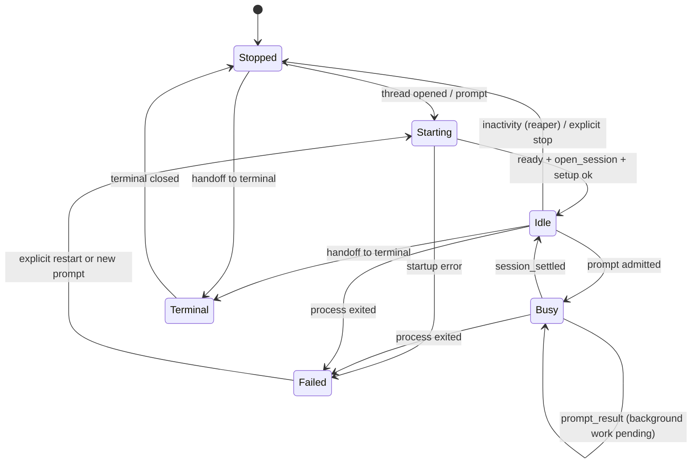

# 02 — Daemon (`omfp daemon`)

The daemon owns repositories, workspaces, threads and omp processes. It serves the protocol in [03](03-protocol.md) and, in web
mode, the UI's static files.

## Startup and configuration

```text
omfp daemon [--bind 127.0.0.1:7420] [--data-dir DIR] [--omp-bin PATH] [--static-dir DIR] [--allow-omp-mismatch]
```

| ID | Requirement |
| --- | --- |
| DMN-001 | On startup the daemon MUST run `omp --version` and compare it with `omfp_core::OMP_VERSION` (the version of the `omp-rpc` tag, see [01](01-dev-environment.md)). On mismatch it MUST refuse to start unless `--allow-omp-mismatch` is given, in which case a warning is also shown in the UI. |
| DMN-002 | The default `--bind` MUST be `127.0.0.1:7420`; any address and port MAY be configured. Exposure beyond the machine (tunnels, reverse proxies, TLS) is the deployer's job (D-13). |
| DMN-003 | On first run the daemon MUST generate a random token (≥ 256 bits) in `<data-dir>/token` with mode `0600`; every WebSocket connection MUST present it (see PRT-002). |
| DMN-004 | The daemon MUST also work as a library (`omfp_daemon::start(config) -> DaemonHandle` exposing the bound address and token) for in-process use by the desktop app (ARC-003). |
| DMN-005 | On SIGTERM/SIGINT or `DaemonHandle::shutdown` the daemon MUST stop every omp process and finish within 10 s. Stopping closes the `omp-rpc` client, which closes omp's stdin and then terminates its process group (SIGTERM, SIGKILL after 1 s); omp-rpc 18.18.6 gives omp no longer drain window. |
| DMN-006 | The omp binary MUST be resolved in this order: `--omp-bin`; the omp bundled next to the daemon executable (packaging, D-14); `omp` on `PATH` (dev shell). The resolved path is logged at startup. |
| DMN-007 | At most one daemon MUST run per data directory (exclusive lock file). A running daemon MUST publish its address in `<data-dir>/daemon.json` (removed on shutdown), so local clients such as `omfp desktop` can find it and authenticate with the `token` file (D-16). |
| DMN-008 | The web UI bundle MUST be resolved in this order: `--static-dir`; the `web/` directory next to the daemon executable when it holds an `index.html` (packaging: the `dx build` output ships there); otherwise only the API is served and a warning is logged. The bundle is served at `/`, unknown paths fall back to `index.html`. |

## Persistence (SQLite)

Schema (`PRAGMA user_version = 2`; migration 2 adds `created_client`):

| Table | Main columns |
| --- | --- |
| `repositories` | `id` (ULID), `name`, `path` (absolute, unique), `default_base_ref`, `remote_url` (nullable), `created_at` |
| `workspaces` | `id` (ULID), `path` (absolute, unique among live workspaces), `kind` (`managed_worktree` \| `adopted`), `repository_id` (nullable), `branch` (nullable), `base_ref` (nullable), `pr_url` (nullable), `pr_number` (nullable), `created_by` (`user` \| thread id), `created_client` (nullable, the creating connection's `client`, PRT-033), `created_at`, `removed_at` (nullable) |
| `threads` | `id` (ULID), `title`, `session_dir`, `omp_session_id` (nullable), `approval_mode` (nullable), `model` (nullable, `provider/id`), `thinking_level` (nullable), `created_by` (`user` \| thread id), `created_client` (nullable), `created_at`, `archived_at` (nullable) |
| `thread_workspaces` | `thread_id`, `workspace_id`, `position` (0 = cwd) — primary key (`thread_id`, `workspace_id`) |
| `thread_tags` | `thread_id`, `tag` |
| `settings` | `key`, `value` (JSON) |

| ID | Requirement |
| --- | --- |
| DMN-010 | Migrations MUST be embedded in the binary and applied in order using `PRAGMA user_version`, each in its own transaction. |
| DMN-011 | The database MUST use `journal_mode=WAL` and `foreign_keys=ON`. |
| DMN-012 | Transcripts are NOT stored in the database: the source of truth is omp's `.jsonl` session in the thread's `session_dir`. |

## Repositories and workspaces

A `Git` port (trait) with a real implementation over the `git` CLI (`tokio::process`) and a fake one for tests. A
`Forge` port (trait) resolves PRs; first implementation over the `gh` CLI **[VERIFY in S-08]**.

| ID | Requirement |
| --- | --- |
| DMN-020 | Registering a repository MUST verify the path is the root of a git repository (`git rev-parse --show-toplevel`) and reject duplicates. Registration is optional: no other feature may require it. |
| DMN-021 | Creating a managed workspace MUST run `git worktree add` in the target repository: new branch (`-b <branch> <path> <base_ref>`, default branch name `omfp/<slug>-<suffix>`, unique in the repo) or existing branch. The repository may be registered or given by path. |
| DMN-022 | Creating a workspace **from a PR** (URL or `owner/repo#N`) MUST fetch the PR head into a local branch, create the worktree on it, and store `pr_url`/`pr_number`. |
| DMN-023 | **Adopting** an existing directory MUST record it as `adopted` (git or not); the daemon MUST never delete an adopted directory, only forget it. |
| DMN-024 | Removing a managed workspace MUST refuse when it has uncommitted changes unless forced, and MUST refuse while a thread with a live process uses it. The branch is kept unless explicitly requested. |
| DMN-025 | Git operations on the same repository MUST be serialized (per-repository lock), because `git worktree` mutates the shared `.git`. |
| DMN-026 | For each git workspace the daemon MUST report: branch, commits ahead/behind `base_ref`, changed files, the diff (`git diff <base_ref>...HEAD` plus uncommitted changes) and the linked PR, for the "Changes" panel. |
| DMN-027 | A workspace MAY be attached to several threads; the daemon MUST expose which threads use it, so the UI can warn about concurrent edits. It MUST NOT forbid it. |

### Threads and workspaces

| ID | Requirement |
| --- | --- |
| DMN-028 | Every thread MUST have its own home directory `threads/<id>/home`, used as the omp cwd (D-11). It holds per-thread omp configuration (e.g. `.omp/mcp.json`, 08) and scratch files; it is never a git workspace. |
| DMN-029 | Attaching a workspace to a thread with a live RPC process MUST send `/add-dir <path>` through `prompt` (omp built-in available over RPC, verified on 18.18.1); detaching MUST send `/remove-dir <path>`. Behavior while the thread is `Busy` **[VERIFY in S-07]**. |

## Agent supervision

Each thread has an actor (tokio task) that owns its `omp_rpc::Client`. The client is blocking: calls go through
`spawn_blocking`, and a dedicated thread reads the event receiver and forwards into a tokio channel.

### Process states



`AwaitingInput` is not a process state but an attribute: there are pending interactive requests (approval, `ask`,
dialogs).

| ID | Requirement |
| --- | --- |
| DMN-030 | The process MUST be started as `omp --mode rpc-ui --session-dir <thread sessions> --continue` with cwd = the thread's home directory (DMN-028), one `--add-dir <path>` per attached workspace in order, plus `--approval-mode` and `--model` when set on the thread. Binding the session at launch is required: S-07 found that `--add-dir` roots do not survive a later `open_session` to another session. |
| DMN-031 | After the `ready` frame the daemon MUST check that protocol v2 was negotiated (`omp-rpc` does it), register its host tools (at connect, through `omp-rpc`), then send in order: `open_session { sessionDir }` (a no-op on the session bound at launch that reports whether it was resumed), `set_event_filter { events: null, messageUpdates: "delta" }` (sent as the daemon's own frame: the generated command of omp-rpc 18.18.6 lacks `messageUpdates`), `set_subagent_subscription { level: "progress" }`, `set_ask_dialog { enabled: true }`. A failure in any step moves the thread to `Failed` with the error message. |
| DMN-032 | After `open_session` the daemon MUST store `sessionId` in `threads.omp_session_id` and load history with `get_messages` (paged by `omp-rpc`) as the reducer's initial event. |
| DMN-033 | Before starting omp on a thread that already has `omp_session_id`, the daemon MUST check the session lease (`omp session lease --json -- <id>`): if another omp process owns the session, startup MUST fail with an error saying so (e.g. the session is open in an external terminal). |
| DMN-034 | A process that is `Idle`, settled, and not watched by any client MUST be stopped after `idle_timeout` (default 15 minutes, configurable). A `Busy` process or one with pending interactive requests is never stopped. |
| DMN-035 | If the process exits unexpectedly, the thread MUST move to `Failed` with the last stderr lines (and the exit code when available — omp-rpc 18.18.6 does not expose it); pending interactive requests MUST be cancelled towards the UI. Restart happens only on the user's next command. |
| DMN-036 | omp's stderr MUST be written to a per-thread log file (`<data-dir>/threads/<id>/omp.log`, rotated) and never mixed with protocol stdout. |
| DMN-037 | Lifecycle operations on a thread (start, stop, restart, attach/detach, handoff to terminal) MUST be serialized by its actor. omp commands are forwarded without waiting for each other, because omp orders them itself and some must overtake a running one (`abort` during `compact`, `steer` during a turn). Different threads proceed in parallel. |
| DMN-038 | The maximum number of concurrent omp processes MUST be configurable (default 8); beyond the limit, starting a stopped thread MUST fail with an explicit error (no silent queueing). |

### Events

| ID | Requirement |
| --- | --- |
| DMN-040 | Every frame received from omp (session events, `prompt_result`, `session_settled`, subagent frames, `available_commands_update`, `notice`, …) MUST get a per-thread increasing `seq` and an `epoch` (identifies the process start), and MUST be applied to the reducer before being forwarded to clients. |
| DMN-041 | The daemon MUST keep, per thread, the last N events in memory (default 2000) so reconnecting clients can catch up (PRT-020). |
| DMN-042 | Unknown frames (`Unknown(Value)` from `omp-rpc`) MUST be forwarded as `unknown` and logged, without stalling the thread. |
| DMN-043 | `agent_end.messages` MUST NOT be used as the complete transcript (it can be compacted); the transcript is built from `message_end` events and the initial history. |

### Interactive requests

| ID | Requirement |
| --- | --- |
| DMN-050 | `extension_ui_request` frames with method `select`, `confirm`, `input`, `editor` or `ask` MUST become interactive requests on the thread, forwarded to every connected client and kept until answered (even if no client is connected). |
| DMN-051 | The first valid answer from any client MUST be forwarded to omp as `extension_ui_response`; later answers to the same request MUST get an `already_resolved` error. |
| DMN-052 | A `cancel` from omp (with `targetId`) MUST close the matching request in every client. |
| DMN-053 | Presentation-only methods (`notify`, `setStatus`, `setWidget`, `set_editor_text`, `open_url`, `setTitle`) MUST become UI events with no reply to omp. |
| DMN-054 | `ask` answers MUST match omp's required shape (one entry per question, in order, exact labels); the daemon MUST validate them before forwarding and reject malformed ones with an error. Note: omp 18.18.6's `ask` tool takes one HTML form and walks it with `select`/`input`/`editor` dialogs instead of the RPC `ask` dialog (contract scenario `ask_answered`); the `ask` method stays supported for extensions that use it. |

### Daemon-provided tools (host tools)

| ID | Requirement |
| --- | --- |
| DMN-060 | The daemon MUST register its host tools when it launches a thread's omp (they are per thread). Initial set: `open_in_editor { path, line? }`, which asks the clients to open the file (an `open_url` presentation request with a `file://…#L<line>` URL). A configurable editor command run by the daemon is left for later. |
| DMN-061 | Every host tool MUST honour cancellation (`HostToolContext::is_cancelled`) and return an error (`isError: true`) instead of panicking. |

## Commands towards omp

Mapping between protocol commands ([03](03-protocol.md)) and omp RPC commands. All go through the thread actor.

| omfp command | omp RPC |
| --- | --- |
| `thread.prompt` | `prompt` (with `streamingBehavior` `steer`/`followUp` when the thread is `Busy`) |
| `thread.steer` / `thread.follow_up` | `steer` / `follow_up` |
| `thread.abort` | `abort_and_restore_queue` (returns queued messages to put back in the composer) |
| `thread.queue.remove` / `thread.queue.promote` | `remove_queued_message` / `promote_queued_message` |
| `thread.set_model` / `thread.set_thinking` | `set_model` / `set_thinking_level` (also stored on the thread) |
| `thread.models` / `thread.thinking_levels` | `get_available_models` / `get_available_thinking_levels` |
| `thread.commands` | `get_available_commands` |
| `thread.compact` | `compact` |
| `thread.tree` / `thread.navigate` / `thread.fork` / `thread.label` | `get_tree` / `navigate_tree` / `fork` / `set_label` |
| `thread.subagents` / `.messages` / `.steer` / `.cancel` | `get_subagents` / `get_subagent_messages` / `steer_subagent` / `cancel_subagent` |
| `thread.goal` | `goal` |
| `thread.btw` | `btw` |
| `thread.bash` | `bash` (with `excludeFromContext` when the `ready` frame supports it) |
| `thread.state` | `get_state` |

| ID | Requirement |
| --- | --- |
| DMN-070 | A command on a `Stopped` thread that needs omp (e.g. `thread.prompt`) MUST start the process first. Read-only commands on a stopped thread (e.g. `thread.tree`) MAY start it. |
| DMN-071 | omp errors (`success: false`, with `code` when present: `session_busy`, `stale_cursor`, `entry_not_found`, …) MUST reach the UI with the same `code`. |
| DMN-072 | After a `fork` the daemon MUST re-read `get_state` and update `omp_session_id` (fork moves the process to a new session file). |
