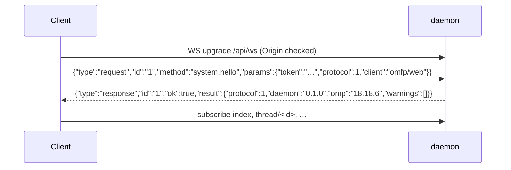

# 03 — UI ↔ daemon protocol

One WebSocket per client at `/api/ws`. JSON text frames for requests, responses and events; binary frames only for
terminal data ([05](05-terminal.md)). All types live in `omfp-protocol` (serde), shared by daemon and UI. Plain HTTP
besides: the web bundle at `/` (DMN-008) and the user's theme at `/theme.css` (DMN-075), both without the token.

## Connection and authentication



| ID | Requirement |
| --- | --- |
| PRT-001 | The first client frame MUST be `system.hello`. Any other frame before a successful hello MUST close the connection with WebSocket close code 4401. |
| PRT-002 | The token MUST travel in the `system.hello` payload, never in the URL (it would end up in logs and history). Comparison MUST be constant-time. |
| PRT-003 | The daemon MUST reject upgrades whose `Origin` is neither the daemon's own origin nor in the configured allow-list (protection against cross-site WebSocket hijacking). |
| PRT-004 | `protocol` is an integer. If the client's version is not supported the daemon MUST answer with error `version_mismatch` listing the supported versions, then close. |
| PRT-005 | The hello response MUST include daemon version, omp version, and warnings (e.g. `--allow-omp-mismatch` in effect). |

## Envelope

```jsonc
// client → daemon
{ "type": "request", "id": "c42", "method": "thread.prompt", "params": { "threadId": "01J…", "text": "…" } }

// daemon → client
{ "type": "response", "id": "c42", "ok": true, "result": { … } }
{ "type": "response", "id": "c42", "ok": false,
  "error": { "code": "omp_error", "message": "…", "ompCode": "session_busy", "details": { … } } }
{ "type": "event", "topic": "thread/01J…", "epoch": "e7", "seq": 1289, "event": { "kind": "omp", "frame": { … } } }
{ "type": "resync_required", "topic": "thread/01J…" }
```

| ID | Requirement |
| --- | --- |
| PRT-010 | Every request MUST have a client-chosen `id`, unique per connection; the response echoes it. Responses MAY arrive out of request order. |
| PRT-011 | Error `code` values are a closed set: `unauthorized`, `bad_request`, `not_found`, `conflict`, `already_resolved`, `limit_reached`, `version_mismatch`, `thread_failed`, `omp_error`, `git_error`, `internal`. `omp_error` carries omp's own `code` in `ompCode` when present (DMN-071). |
| PRT-012 | Unknown `method` MUST yield `bad_request`; unknown fields in `params` MUST be ignored (forward compatibility). |
| PRT-013 | A single frame MUST NOT exceed 16 MiB. Larger payloads (huge diffs, long transcripts) MUST be paged or truncated with an explicit `truncated: true`. |

## Topics, snapshots and catch-up

Topics: `index` (known repositories, workspaces with their discovered repositories, threads with their summaries and
tags, and the user's theme), `thread/<id>` (one thread), `workspace/<id>` (git status of each repository of one
workspace), `terminal/<id>` (terminal output, [05](05-terminal.md)).

The `index` state is `{ repositories, workspaces, threads, theme, settings }`; its events are `repository_upserted` /
`repository_removed`, `workspace_upserted` / `workspace_removed`, `thread_upserted` / `thread_removed`,
`theme_changed { theme }` (`theme` is `{ css: string | null }`, DMN-075) and `settings_changed { settings }` (DMN-009,
UI-097). `settings` is `{ ui: { density?, notifications?, fonts?: { prose?, ui?, code? } }, keymap: { mode: "normal" |
"insert" | "cmdline", keys, command }[], error: string | null }`: the `[ui]` and `[keymap]` tables of the daemon's
config file (absent values are defaults; `command: ""` removes a default binding), and the last reload error (the
previous settings stay). A thread summary carries `title` (`""` until the first message) and `titleSource`:
`placeholder` (the first words of the first message), `generated` or `set` (DMN-073).

```jsonc
// subscribe, optionally from a known position
{ "type": "request", "id": "c7", "method": "subscribe",
  "params": { "topic": "thread/01J…", "since": { "epoch": "e7", "seq": 1200 } } }

// answer A: catch-up from the ring buffer — events 1201.. follow as normal "event" frames
{ "type": "response", "id": "c7", "ok": true, "result": { "mode": "replay", "epoch": "e7", "fromSeq": 1201 } }

// answer B: position unknown or too old — full state, then live events after `seq`
{ "type": "response", "id": "c7", "ok": true,
  "result": { "mode": "snapshot", "epoch": "e9", "seq": 40, "state": { /* omfp_core::ThreadState */ } } }
```

| ID | Requirement |
| --- | --- |
| PRT-020 | `subscribe` with `since` inside the thread's ring buffer (same `epoch`, `seq` ≥ oldest kept) MUST replay the missing events in order; otherwise it MUST return a snapshot. Without `since`, it returns a snapshot. |
| PRT-021 | The snapshot MUST be the `omfp_core::ThreadState` produced by the daemon's reducer at exactly `seq`; applying the following events with the same reducer MUST produce the same state the daemon has (invariant tested by property tests, TST-011). |
| PRT-022 | Events for a topic MUST be delivered in strictly increasing `seq` order without gaps. When a thread's process restarts, the live subscription continues in the new `epoch` from `seq` 1 (the state carries over; the epoch's first events are the new history and process state). A client that observes a gap, or a new `epoch` starting anywhere but `seq` 1, MUST resubscribe. |
| PRT-023 | Each client has a bounded outbound queue. On overflow the daemon MUST drop that client's topic, send `resync_required` for it, and keep the connection open; the client resubscribes and gets a snapshot. |
| PRT-024 | `unsubscribe { topic }` MUST stop delivery for that topic. Closing the socket unsubscribes everything. |
| PRT-025 | The daemon MUST know which threads are being watched (at least one subscriber) for the idle reaper (DMN-034). |

## Event kinds on `thread/<id>`

| `event.kind` | Contents |
| --- | --- |
| `omp` | An omp frame as received (`omp_rpc::wire` types): session events, `prompt_result`, `session_settled`, subagent frames, `available_commands_update`, `notice`, `queue_update`, … |
| `history` | Initial history after process start (`get_messages`), applied by the reducer as a reset of the transcript |
| `process` | Process state change (`Stopped`, `Starting`, `Idle`, `Busy`, `Failed { exitCode, stderrTail }`, `Terminal`) |
| `interaction_opened` / `interaction_closed` | Pending interactive request opened / answered / cancelled (DMN-050..052) |
| `presentation` | `notify`, `setStatus`, `setWidget`, `set_editor_text`, `open_url`, `setTitle` (DMN-053) |
| `thread_meta` | Title, model, thinking level, branch, git summary changed |
| `unknown` | Unknown omp frame (DMN-042) |

## Methods

| Method | Params | Result |
| --- | --- | --- |
| `system.hello` | `token`, `protocol`, `client` | versions, warnings |
| `subscribe` / `unsubscribe` | `topic`, `since?` | see above |
| `repos.add` / `.remove` / `.list` | `path` / `repositoryId` | known repository / list (DMN-021) |
| `workspaces.create` | `name?`, `path?` (existing folder; omitted = new folder under the workspaces root) | workspace |
| `workspaces.update` | `workspaceId`, `name` | workspace |
| `workspaces.remove` | `workspaceId`, `deleteFolder?`, `force?` | `{}` (DMN-028) |
| `workspaces.rescan` | `workspaceId` | workspace (DMN-023) |
| `workspaces.add_repo` | `workspaceId`, `name?`, `source`: `link { path }` \| `worktree { repo (id or path), branch?, baseRef? }` \| `clone { url }` \| `pr { pr }` (after S-08) | workspace (DMN-024) |
| `workspaces.remove_repo` | `workspaceId`, `name`, `force?`, `deleteBranch?` | workspace (DMN-025) |
| `workspaces.status` / `.diff` | `workspaceId`, `repo` (name), `path?`, `cursor?` | status / paged diff of one repository |
| `threads.create` | `workspace`: `{ id }` \| `{ new: { name?, path? } }` (default: a new folder named after the title, else the first message), `prompt?` (first message), `tags[]`, `model?`, `thinkingLevel?`, `approvalMode?` (default `yolo`, DMN-074), `title?` (scripts and agents; otherwise generated, DMN-073) | thread |
| `threads.update` | `threadId`, `title?` (a `set` title, DMN-073), `tags?`, `approvalMode?` (from the next start of the thread's omp) | thread |
| `threads.archive` / `.unarchive` / `.delete` | `threadId` | `{}`; archive stops the thread's omp process and sets `archivedAt`, unarchive clears it, delete removes the thread's records and directory (workspaces are never removed implicitly) |
| `thread.prompt` | `threadId`, `text`, `images?`, `behavior?: "steer" \| "followUp"` | `{ promptId }`; completion arrives as `prompt_result` |
| `thread.steer` / `thread.follow_up` | `threadId`, `text`, `images?` | `{}` |
| `thread.abort` | `threadId` | `{ steering[], followUp[] }` (to restore into the composer) |
| `thread.queue.remove` / `.promote` | `threadId`, `message`, `queue?` | `{ removed }` / `{ promoted }` |
| `thread.set_model` / `thread.set_thinking` | `threadId`, `provider`+`modelId` / `level` | `{}` |
| `thread.models` / `thread.thinking_levels` / `thread.commands` | `threadId` | `{ models }` / `{ levels }` / `{ commands }` |
| `thread.compact` | `threadId`, `instructions?` | compaction result |
| `thread.tree` / `.navigate` / `.fork` / `.label` | `threadId`, `entryId?`, … | tree / result |
| `thread.subagents` / `.subagent_messages` / `.subagent_steer` / `.subagent_cancel` | `threadId`, `subagentId`, … | `{ subagents }` / transcript page / `{}` |
| `thread.goal` / `thread.btw` / `thread.bash` | per 02 | `{ goal, state }` / `{ record }` / bash result |
| `thread.git` | `threadId` | `{ workspaceId, repos }`: the status of every repository of the thread's workspace (convenience over `workspaces.status`) |
| `thread.restart` / `thread.stop` | `threadId` | `{}` |
| `interaction.respond` | `threadId`, `interactionId`, `response` (`value` \| `confirmed` \| `cancelled` \| `answers`) | `{}` or `already_resolved` |
| `terminal.*` | see [05](05-terminal.md) | |
| `theme.get` | — | `{ css }`: the user's theme CSS, `null` when none (DMN-075) |
| `theme.set` | `css` (string, at most 1 MiB, else `bad_request`; `null` restores the built-in themes) | `{}`; every client gets `theme_changed` on `index` |
| `settings.get` | — | `settings` (DMN-009, UI-097) |
| `settings.set` | `ui?` (values to set; absent ones unchanged), `keymap?` (entries replacing the ones with the same `mode` and `keys`) | the new `settings`; merged into the config file, written back with its comments and other keys (`bad_request` for an invalid value or a config file that is not valid TOML); every client gets `settings_changed` |

Results of omp-forwarded methods are omp's response data (`data` of its `response` frame), the `omp-rpc` wire
`*Result` type named in the method table, even where `omp-rpc` decodes the command's output to the bare list or
record (`get_available_models` → `{ models }`, not `[ModelInfo]`).

| ID | Requirement |
| --- | --- |
| PRT-030 | `thread.prompt` MUST return as soon as omp admits the prompt (omp's `prompt` response), not when the turn ends. The UI tracks completion through `prompt_result` with the same `promptId`. omp numbers requests per process, so a `promptId` is unique only within the thread's current epoch; the reducer drops prompt results when a new process starts (History). |
| PRT-031 | Every method MUST be covered by a golden-JSON test (insta snapshot of request and response) in `omfp-protocol`, so changes to the wire format are always explicit in review. |
| PRT-032 | `omfp-protocol` MUST version breaking changes by bumping `protocol`; the daemon supports the current and the previous version during a transition. |
| PRT-033 | No method may assume a human UI is on the other end: every method is usable by scripts and, later, agents (D-12). The `client` field of `system.hello` and the resulting principal are recorded as provenance on created entities (ARC-009). |
| PRT-034 | Authorization MUST be resolved once per connection into a `Principal` and checked in one place (a method → permission table), so scoped principals (per-thread agent tokens, [08](08-agent-control.md)) can be added without touching method handlers. Today there is one principal: the owner token. |
