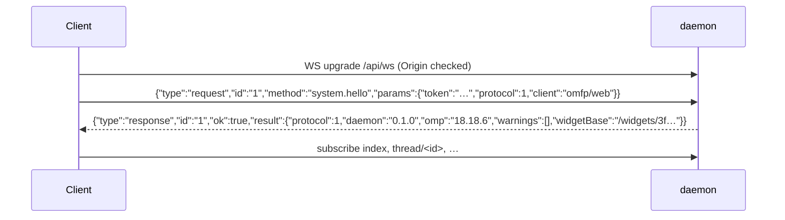

# 03 — UI ↔ daemon protocol

One WebSocket per client at `/api/ws`. JSON text frames for requests, responses and events; binary frames only for
terminal data ([05](05-terminal.md)). All types live in `omfp-protocol` (serde), shared by daemon and UI. Plain HTTP
besides: the web bundle at `/` (DMN-008) and the user's theme at `/theme.css` (DMN-075), both without the token, and
widget modules under the `widgetBase` path a client gets in `system.hello` (DMN-084, PRT-042).

## Connection and authentication



| ID | Requirement |
| --- | --- |
| PRT-001 | The first client frame MUST be `system.hello`. Any other frame before a successful hello MUST close the connection with WebSocket close code 4401. |
| PRT-002 | The token MUST travel in the `system.hello` payload, never in the URL (it would end up in logs and history). Comparison MUST be constant-time. |
| PRT-003 | The daemon MUST reject upgrades whose `Origin` is neither the daemon's own origin nor in the configured allow-list (protection against cross-site WebSocket hijacking). |
| PRT-004 | `protocol` is an integer. If the client's version is not supported the daemon MUST answer with error `version_mismatch` listing the supported versions, then close. |
| PRT-005 | The hello response MUST include daemon version, omp version, and warnings (e.g. `--allow-omp-mismatch` in effect). |

## Envelope

```jsonc
// client → daemon
{ "type": "request", "id": "c42", "method": "thread.prompt", "params": { "threadId": "01J…", "text": "…" } }

// daemon → client
{ "type": "response", "id": "c42", "ok": true, "result": { … } }
{ "type": "response", "id": "c42", "ok": false,
  "error": { "code": "omp_error", "message": "…", "ompCode": "session_busy", "details": { … } } }
{ "type": "event", "topic": "thread/01J…", "epoch": "e7", "seq": 1289, "event": { "kind": "omp", "frame": { … } } }
{ "type": "resync_required", "topic": "thread/01J…" }
{ "type": "transient", "topic": "thread/01J…", "event": { "kind": "live_levels", "input": 0.12, "output": 0.3 } }
```

| ID | Requirement |
| --- | --- |
| PRT-010 | Every request MUST have a client-chosen `id`, unique per connection; the response echoes it. Responses MAY arrive out of request order. |
| PRT-011 | Error `code` values are a closed set: `unauthorized`, `bad_request`, `not_found`, `conflict`, `already_resolved`, `limit_reached`, `version_mismatch`, `thread_failed`, `omp_error`, `git_error`, `internal`. `omp_error` carries omp's own `code` in `ompCode` when present (DMN-071). |
| PRT-012 | Unknown `method` MUST yield `bad_request`; unknown fields in `params` MUST be ignored (forward compatibility). |
| PRT-013 | A single frame MUST NOT exceed 16 MiB. Larger payloads (huge diffs, long transcripts) MUST be paged or truncated with an explicit `truncated: true`. |

## Topics, snapshots and catch-up

Topics: `index` (workspaces with their discovered repositories, threads with their summaries, and the user's theme),
`thread/<id>` (one thread), `workspace/<id>` (git status of each repository of one workspace), `views/<id>` (the views
manifest, widget folders and widget state of one workspace, PRT-040), `job/<id>` (one job's output, PRT-041),
`terminal/<id>` (terminal output, [05](05-terminal.md)).

The `index` state is `{ workspaces, threads, theme, settings }`; its events are
`workspace_upserted` / `workspace_removed`, `thread_upserted` / `thread_removed`,
`theme_changed { theme }` (`theme` is `{ css: string | null }`, DMN-075) and `settings_changed { settings }` (DMN-009,
UI-097). `settings` is `{ ui: { density?, notifications?, fonts?: { prose?, ui?, code? } }, keymap: { mode: "normal" |
"insert" | "cmdline", keys, command }[], error: string | null }`: the `[ui]` and `[keymap]` tables of the daemon's
config file (absent values are defaults; `command: ""` removes a default binding), and the last reload error (the
previous settings stay). A thread summary carries `title` (`""` until the first message) and `titleSource`:
`placeholder` (the first words of the first message), `generated` or `set` (DMN-073).

```jsonc
// subscribe, optionally from a known position
{ "type": "request", "id": "c7", "method": "subscribe",
  "params": { "topic": "thread/01J…", "since": { "epoch": "e7", "seq": 1200 } } }

// answer A: catch-up from the ring buffer — events 1201.. follow as normal "event" frames
{ "type": "response", "id": "c7", "ok": true, "result": { "mode": "replay", "epoch": "e7", "fromSeq": 1201 } }

// answer B: position unknown or too old — full state, then live events after `seq`
{ "type": "response", "id": "c7", "ok": true,
  "result": { "mode": "snapshot", "epoch": "e9", "seq": 40, "state": { /* omfp_core::ThreadState */ } } }
```

| ID | Requirement |
| --- | --- |
| PRT-020 | `subscribe` with `since` inside the thread's ring buffer (same `epoch`, `seq` ≥ oldest kept) MUST replay the missing events in order; otherwise it MUST return a snapshot. Without `since`, it returns a snapshot. |
| PRT-021 | The snapshot MUST be the `omfp_core::ThreadState` produced by the daemon's reducer at exactly `seq`; applying the following events with the same reducer MUST produce the same state the daemon has (invariant tested by property tests, TST-011). |
| PRT-022 | Events for a topic MUST be delivered in strictly increasing `seq` order without gaps. When a thread's process restarts, the live subscription continues in the new `epoch` from `seq` 1 (the state carries over; the epoch's first events are the new history and process state). A client that observes a gap, or a new `epoch` starting anywhere but `seq` 1, MUST resubscribe. |
| PRT-023 | Each client has a bounded outbound queue. On overflow the daemon MUST drop that client's topic, send `resync_required` for it, and keep the connection open; the client resubscribes and gets a snapshot. |
| PRT-024 | `unsubscribe { topic }` MUST stop delivery for that topic. Closing the socket unsubscribes everything. |
| PRT-025 | The daemon MUST know which threads are being watched (at least one subscriber) for the idle reaper (DMN-034). |

## Event kinds on `thread/<id>`

| `event.kind` | Contents |
| --- | --- |
| `omp` | An omp frame as received (`omp_rpc::wire` types): session events, `prompt_result`, `session_settled`, subagent frames, `available_commands_update`, `notice`, `queue_update`, … |
| `history` | Initial history after process start (`get_messages`), applied by the reducer as a reset of the transcript |
| `process` | Process state change (`Stopped`, `Starting`, `Idle`, `Busy`, `Failed { exitCode, stderrTail }`, `Terminal`) |
| `interaction_opened` / `interaction_closed` | Pending interactive request opened / answered / cancelled (DMN-050..052) |
| `presentation` | `notify`, `setStatus`, `setWidget`, `set_editor_text`, `open_url`, `setTitle` (DMN-053) |
| `thread_meta` | Title, model, thinking level, branch, git summary changed |
| `live_session` | `{ owner: { client, connection } \| null }`: the daemon opened a live session for that connection (before forwarding `live_connect` or `live_start`), or closed one omp never started (M6, DMN-100, DMN-101, DMN-109); omp's own `live_phase`, `live_transcript` and `live_end` frames arrive as `omp` events, its `live_levels` as transient frames (PRT-054) |
| `open_file` | `{ id, connection, path, line }`: the agent's `omfp_open_file` asks the window on that connection (PRT-051) to open `path` at `line` (`null` for none); the state keeps the last request as `open_file`, and the window opens each `id` once (DMN-060, UI-116) |
| `notify` | `{ id, connection, title, body }`: the agent's `omfp_notify` asks the window on that connection (PRT-051) to notify the user about the thread; the state keeps the last request as `notify`, and the window shows each `id` once (DMN-125, PRT-065, UI-215) |
| `unknown` | Unknown omp frame (DMN-042) |

## Methods

| Method | Params | Result |
| --- | --- | --- |
| `system.hello` | `token`, `protocol`, `client` | versions, warnings, `widgetBase`, `connection` (PRT-051) |
| `subscribe` / `unsubscribe` | `topic`, `since?` | see above |
| `repos.suggest` | `query?` | `{ repos: [{ path, name, lastSeenAt }] }`: repositories seen in any workspace (DMN-021) |
| `fs.complete` | `path` | `{ entries: [{ name, path, isGitRoot }] }`: child directories on the daemon host (DMN-021) |
| `workspaces.create` | `name?`, `link?` (a repository path: the new folder gets a link to it, DMN-020) | workspace; always a new folder under the workspaces root |
| `workspaces.update` | `workspaceId`, `name` | workspace |
| `workspaces.remove` | `workspaceId`, `force?` | `{}`; removes the repositories and deletes the folder (DMN-028) |
| `workspaces.rescan` | `workspaceId` | workspace (DMN-023; the daemon also rescans watched workspaces on its own) |
| `workspaces.add_repo` | `workspaceId`, `name?`, `source`: `link { path }` \| `worktree { repo (id or path), branch?, baseRef? }` \| `clone { url }` \| `pr { pr }` (later, S-08) | workspace (DMN-024) |
| `workspaces.remove_repo` | `workspaceId`, `name`, `force?`, `deleteBranch?` | workspace (DMN-025) |
| `workspaces.status` / `.diff` | `workspaceId`, `repo` (name), `path?`, `cursor?` | status / paged diff of one repository; `status` rescans the workspace first and publishes the fresh status of all its repositories on `workspace/<id>` when it changed (what `omfp:changes` uses to refresh, UI-080) |
| `workspaces.read_file` | `workspaceId`, `path`, `knownHash?` | `{ path, kind: "text" \| "image" \| "binary", size, hash, unchanged, content?, truncated, mime?, repo?, head? }`: a file of the workspace with its `HEAD` text (DMN-089) |
| `workspaces.find_file` | `workspaceId`, `query`, `threadId?` | `{ candidates: [{ path, repo?, match: "exact" \| "suffix" \| "basename", mentioned }], truncated }`: the files a bare or partial name names, best first, at most 50, those the thread's tool cards name first among equal matches (DMN-092) |
| `workspaces.write_file` | `workspaceId`, `path`, `content`, `expectedHash?` | `{ path, hash, size }`; `conflict` when the file no longer has `expectedHash` (or exists without it), nothing written (DMN-090) |
| `threads.create` | `workspace`: `{ id }` \| `{ new: { name?, link? } }` (default: a new folder named after the title, else the first message), `prompt?` (first message), `model?`, `thinkingLevel?`, `approvalMode?` (default `yolo`, DMN-074), `title?` (scripts and agents; otherwise generated, DMN-073) | thread |
| `threads.update` | `threadId`, `title?` (a `set` title, DMN-073), `approvalMode?` (from the next start of the thread's omp) | thread |
| `threads.archive` / `.unarchive` / `.delete` | `threadId` | `{}`; archive stops the thread's omp process and sets `archivedAt`, unarchive clears it, delete removes the thread's records and directory (workspaces are never removed implicitly) |
| `threads.search` | `query` | `{ results: [{ threadId, snippet }] }`: threads whose conversation text contains `query`, most recently updated first (DMN-076) |
| `thread.prompt` | `threadId`, `text`, `images?`, `behavior?: "steer" \| "followUp"` | `{ promptId }`; completion arrives as `prompt_result` |
| `thread.steer` / `thread.follow_up` | `threadId`, `text`, `images?` | `{}` |
| `thread.abort` | `threadId` | `{ steering[], followUp[] }` (to restore into the composer) |
| `thread.queue.remove` / `.promote` | `threadId`, `message`, `queue?` | `{ removed }` / `{ promoted }` |
| `thread.set_model` / `thread.set_thinking` | `threadId`, `provider`+`modelId` / `level` | `{}` |
| `thread.models` / `thread.thinking_levels` / `thread.commands` | `threadId` | `{ models }` / `{ levels }` / `{ commands }` |
| `thread.compact` | `threadId`, `instructions?` | compaction result |
| `thread.tree` / `.navigate` / `.fork` / `.label` | `threadId`, `entryId?`, … | tree / result |
| `thread.subagents` / `.subagent_messages` / `.subagent_steer` / `.subagent_cancel` | `threadId`, `subagentId`, … | `{ subagents }` / transcript page / `{}` |
| `thread.goal` / `thread.btw` / `thread.bash` | per 02 | `{ goal, state }` / `{ record }` / bash result |
| `thread.git` | `threadId` | `{ workspaceId, repos }`: the status of every repository of the thread's workspace (convenience over `workspaces.status`) |
| `thread.restart` / `thread.stop` | `threadId` | `{}` |
| `thread.live_connect` | `threadId`, `sdpOffer` (the browser peer's SDP offer: one sendrecv Opus track plus an `oai-events` data channel) | `{ sdpAnswer, voice }` once omp signaled the call (DMN-100); `conflict` while the thread has a live session (DMN-101) |
| `thread.live_start` | `threadId` | `{ voice }` once omp's own session on the daemon's machine records (M7, DMN-109); `conflict` while the thread has a live session (DMN-101) |
| `thread.live_stop` | `threadId` | `{}`; succeeds without a session and never starts omp (DMN-102) |
| `thread.live_mute` | `threadId`, `muted` | `{ muted }`; `conflict` without a live session (DMN-102) |
| `interaction.respond` | `threadId`, `interactionId`, `response` (`value` \| `confirmed` \| `cancelled` \| `answers`) | `{}` or `already_resolved` |
| `terminal.*` | see [05](05-terminal.md) | |
| `theme.get` | — | `{ css }`: the user's theme CSS, `null` when none (DMN-075) |
| `theme.set` | `css` (string, at most 1 MiB, else `bad_request`; `null` restores the built-in themes) | `{}`; every client gets `theme_changed` on `index` |
| `settings.get` | — | `settings` (DMN-009, UI-097) |
| `settings.set` | `ui?` (values to set; absent ones unchanged), `keymap?` (entries replacing the ones with the same `mode` and `keys`) | the new `settings`; merged into the config file, written back with its comments and other keys (`bad_request` for an invalid value or a config file that is not valid TOML); every client gets `settings_changed` |
| `views.set` | `workspaceId`, `manifest` (AGT-010) | `{}`; writes `.omfp/views.json` (DMN-083) |
| `widgets.copy` | `workspaceId`, `widget` (`omfp:<name>` \| `user:<name>`), `name?` | `{ name }`: the new folder `.omfp/widgets/<name>/` (DMN-087) |
| `widgets.state_set` | `workspaceId`, `instance`, `key`, `value` (JSON; `null` deletes) | `{}`; `widget_stored` on `views/<id>` (DMN-086) |
| `widgets.report` | `workspaceId`, `views` (the `{ epoch, seq }` of `views/<workspaceId>` the window rendered, `null` before it arrived), `widgets` (per instance: `reference`, `instance`, `source`, `name`, `version`, `state`, `errors`, `console`, `text`, `jobs`) | `{}`; replaces this connection's report (PRT-043, AGT-026) |
| `jobs.start` | `workspaceId`, `command` | the job: `{ id, workspaceId, command, startedAt, status }` (DMN-080) |
| `jobs.kill` | `jobId` | `{}` (DMN-081) |

Results of omp-forwarded methods are omp's response data (`data` of its `response` frame), the `omp-rpc` wire
`*Result` type named in the method table, even where `omp-rpc` decodes the command's output to the bare list or
record (`get_available_models` → `{ models }`, not `[ModelInfo]`).

| ID | Requirement |
| --- | --- |
| PRT-030 | `thread.prompt` MUST return as soon as omp admits the prompt (omp's `prompt` response), not when the turn ends. The UI tracks completion through `prompt_result` with the same `promptId`. omp numbers requests per process, so a `promptId` is unique only within the thread's current epoch; the reducer drops prompt results when a new process starts (History). |
| PRT-031 | Every method MUST be covered by a golden-JSON test (insta snapshot of request and response) in `omfp-protocol`, so changes to the wire format are always explicit in review. |
| PRT-032 | `omfp-protocol` MUST version breaking changes by bumping `protocol`; the daemon supports the current and the previous version during a transition. |
| PRT-033 | No method may assume a human UI is on the other end: every method is usable by scripts and, later, agents (D-12). The `client` field of `system.hello` and the resulting principal are recorded as provenance on created entities (ARC-009). |
| PRT-034 | Authorization MUST be resolved once per connection into a `Principal` and checked in one place (a method → permission table), so scoped principals (per-thread agent tokens, [08](08-agent-control.md)) can be added without touching method handlers. Today there is one principal: the owner token. |
| PRT-050 | The live voice methods (M6) MUST have exactly these shapes: `thread.live_connect { threadId, sdpOffer }` → `{ sdpAnswer, voice }`, `thread.live_stop { threadId }` → `{}`, `thread.live_mute { threadId, muted }` → `{ muted }`; they need the `Drive` permission. |
| PRT-051 | The `system.hello` result MUST carry `connection`, a number naming this connection, unique while the daemon runs: a window compares it with a live session's `owner.connection` to know whether the session (and its audio peer) is its own. |
| PRT-052 | The thread state MUST carry the live session (`live`, `null` when none) and the readable message of the last live failure (`live_error`): a `live_session` event with an owner starts a session `{ owner, phase: null, transcript: [] }` and clears `live_error`; `live_phase` sets `phase` while a session exists (the `error` phase omp repeats after `live_end` is ignored); `live_transcript` keeps one line `{ role, turn, text, final }` per role and turn in order of first appearance, a later frame replacing the line's text until a `final` one (later frames of a final line are ignored); `live_levels` changes nothing (the daemon sends them as transient frames, DMN-110, PRT-054); `live_end` and `live_session { owner: null }` clear the session, `live_end` setting `live_error` to the readable message of its `error` (DMN-104) or `null`; a process leaving `starting`/`running` clears the session. |
| PRT-053 | `thread.live_start { threadId }` (M7) MUST answer `{ voice }` and need the `Drive` permission, like the other live voice methods (PRT-050). |
| PRT-054 | A **transient frame** `{ type: "transient", topic, event }` carries a momentary value of a topic outside its event stream: it has no `seq`, is never replayed nor part of a snapshot, goes only to the connections subscribed to the topic when it happens, and is dropped (no `resync_required`) when a client's queue is full. Its `event` is a `TransientEvent`, tagged by `kind`; the only one is `live_levels { input, output }` on `thread/<id>` (DMN-110). A client hands transient frames of the topics it follows to their listeners (`Client.onTransient`) and never folds them into its model. |
| PRT-055 | The thread state MUST carry `subagents`: per subagent id, the last `subagent_lifecycle` payload (`lifecycle`) and the last `subagent_progress` payload (`progress`, its id read from the raw `AgentProgress` record), each `null` until omp sent one; finished subagents stay (omp's `thread.subagents` lists only running ones, so the UI merges both, UI-081). |
| PRT-056 | The thread state MUST carry `goal`: the `goal` of the last `goal_updated` frame (`null` when omp reported none, or never did); a `history` event keeps it, since the goal belongs to the omp session, not to the transcript. A `goal_updated` without a `goal` key does not decode (an `unknown` notice). |
| PRT-057 | The thread state MUST carry `todo_phases`: the phases of the transcript's last `todo` tool result that committed some (omp's `committedTodoPhases`: not an error, not a `view`, phases that decode), `[]` without one; a `message_end` of such a result replaces them, and a `history` event recomputes them from its messages (omp's `getLatestTodoSnapshotIdentity`). |

## Views and jobs (M4)

| ID | Requirement |
| --- | --- |
| PRT-040 | `views/<workspaceId>` (DMN-082): the state is `ViewsState { manifest, error, widgets: [{ source: "workspace" \| "user", name, version, entry }], stored: { <instance>: { <key>: value } } }`; its events are `views_manifest { manifest, error }` and `views_widgets { widgets }` (each replaces those fields) and `widget_stored { instance, key, value }` (`null` removes the key). Subscribing to an unknown workspace is `not_found`. |
| PRT-041 | `job/<id>` (DMN-080): the state is `JobState { job, lines: [{ stream: "stdout" \| "stderr", text }], dropped }`; its events are `job_output { stream, text }` (appends a line) and `job_exited { code, signal, endedAt }` (the job's `status` becomes `{ state: "exited", code, signal, endedAt }`). Subscribing to an unknown job is `not_found`. |
| PRT-042 | The `system.hello` result MUST carry `widgetBase`, the path under which this daemon serves widget modules to authenticated clients (DMN-084). |
| PRT-043 | `widgets.report` (AGT-026) is a window's report on the workspace and user widgets of the view it shows (built-ins are not reported): each call replaces the connection's previous report (a window shows one workspace), the daemon forgets it when the connection closes, and `omfp_widget_check` reads it (DMN-063). An instance's `state` is `loading`, `rendered`, `compile_error`, `load_error` or `render_error`; `errors` are the import's, compile stand-in's or error boundary's messages (`file:line:column: message` when known), `console` the console errors and uncaught errors whose stack names the widget's module, `text` the rendered text, `jobs` its `useJob` jobs (`command`, `status`, `exitCode`, `signal`, `runs`, `startedAt`, `tail`: the last output lines). The daemon keeps at most 4,000 characters of `text`, 20 `errors`, 20 `console` entries and 10 `tail` lines per instance, each entry at most 2,000 characters. |
| PRT-060 | `ViewsState` (PRT-040) carries `keymap: [{ mode, keys, command, args? }]` and `keymapError: string \| null`, the workspace's `.omfp/keymap.json` (DMN-121); the event `views_keymap { keymap, error }` replaces both. A state without them (an older daemon) reads as no bindings and no error. |
| PRT-065 | The thread state MUST carry `notify`, the last `notify` event's request `{ id, connection, title, body }` (`null` before one; a process change keeps it), like `open_file`; an event missing a field or with a negative `connection` does not decode and changes nothing. A window acts only on requests naming its own connection, once per `id`, so a snapshot after a resync never shows one twice. |
