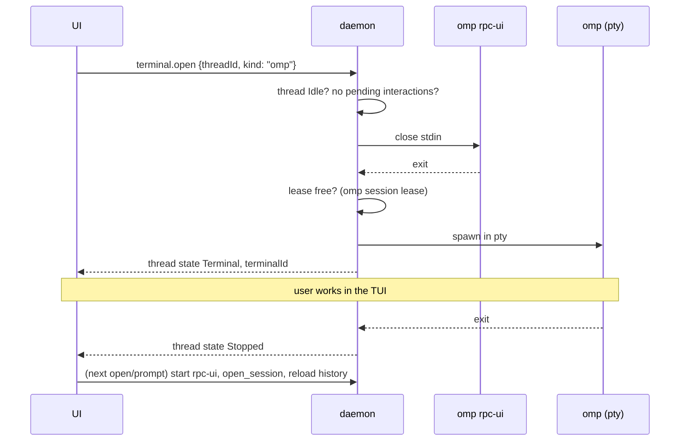

# 05 — Terminal (escape hatch to the TUI)

**Status:** deferred (D-06, not planned). Kept as the design to resume if TUI-only features or a shell panel become
necessary.

RPC does not expose everything the omp TUI can do (verified on omp 18.18.1: plan mode, `/vibe`, `/settings`, `/agents`,
`/collab`, `/record`, `/pause`, `/advisor configure`, and extension UI built from TUI components are missing; see
`docs/rpc.md` → "Extension UI Sub-Protocol" and `slash-command-internals.md` upstream). For these, a thread can be
handed to **interactive omp in a terminal panel**, on the same session. The same panel also hosts plain shells in any
workspace.

## Terminal kinds

| Kind | Command | cwd | Conflicts with the RPC process |
| --- | --- | --- | --- |
| `omp` | `omp --session-dir <thread session_dir> --continue --add-dir <repo>…` | the workspace folder (DMN-030) | yes: only one owner per session (ARC-005) |
| `shell` | `$SHELL -l` | the workspace folder or one of its repositories | no |

`--session-dir <dir> --continue` is the interactive equivalent of RPC's `open_session { sessionDir }`, so both sides
open the same session. The `--add-dir` flags are passed explicitly, with the same cwd as the RPC process, so the TUI sees
exactly the workspaces the thread has.

## Handoff

| ID | Requirement |
| --- | --- |
| TRM-001 | Opening an `omp` terminal MUST require the thread to be `Idle` or `Stopped` with no pending interactions. If it is `Busy`, the daemon MUST answer `conflict`; the UI then offers "abort and open" (abort first, then retry). |
| TRM-002 | The daemon MUST stop the RPC process gracefully (close stdin, wait for exit, max 10 s) and check that the session lease is free before spawning the terminal process. |
| TRM-003 | While an `omp` terminal is open, the thread's process state MUST be `Terminal` and every command that needs the RPC process MUST fail with `conflict` ("open in terminal"). |
| TRM-004 | When the `omp` terminal process exits, the thread MUST become `Stopped`; the next start reloads history (DMN-032), so whatever happened in the TUI appears in the transcript. |
| TRM-005 | `shell` terminals MUST NOT change the thread's process state and MAY be open while the agent runs. |
| TRM-006 | Terminal processes MUST get `TERM=xterm-256color`, `COLORTERM=truecolor`, and `PI_TUI_NATIVE=0` (no Tern Surface Protocol probe). |
| TRM-007 | Deleting or archiving a thread MUST close its terminals (SIGHUP, then SIGKILL after 5 s). |

## Protocol

| Method | Params | Result |
| --- | --- | --- |
| `terminal.open` | `kind: "omp"` + `threadId`, or `kind: "shell"` + `threadId?` / `workspaceId?`; `cols`, `rows` | `{ terminalId, channel }` |
| `terminal.resize` | `terminalId`, `cols`, `rows` | `{}` |
| `terminal.close` | `terminalId` | `{}` |
| `terminal.list` | `threadId?`, `workspaceId?` | open terminals |
| `subscribe` | `topic: "terminal/<id>"` | replays the scrollback buffer, then live output |

Output and input travel as **binary** WebSocket frames: `[u32 channel, big-endian][bytes]`. `channel` is assigned by
`terminal.open` and is valid for that connection only.

| ID | Requirement |
| --- | --- |
| TRM-010 | The daemon MUST keep the last 1 MiB of output per terminal and replay it on subscribe, then nudge a redraw (resize to the same size, which sends SIGWINCH) so full-screen programs repaint. |
| TRM-011 | Several clients MAY attach to the same terminal; all receive output and any of them can type. The most recent `terminal.resize` wins. |
| TRM-012 | Input frames for an unknown or foreign channel MUST be dropped and logged, never written to another terminal. |

## UI

| ID | Requirement |
| --- | --- |
| TRM-020 | The terminal panel uses **xterm.js** (plus the fit addon), vendored as pinned files with integrity hashes and loaded through Dioxus assets; no Node toolchain. |
| TRM-021 | The Rust ↔ xterm.js bridge MUST go through `document::eval` message passing, which works on both web and desktop builds. |
| TRM-022 | The thread view MUST show clearly when a thread is in terminal mode, with a "return to app" action that closes the `omp` terminal (sends `/exit` then SIGHUP after a grace period). |
