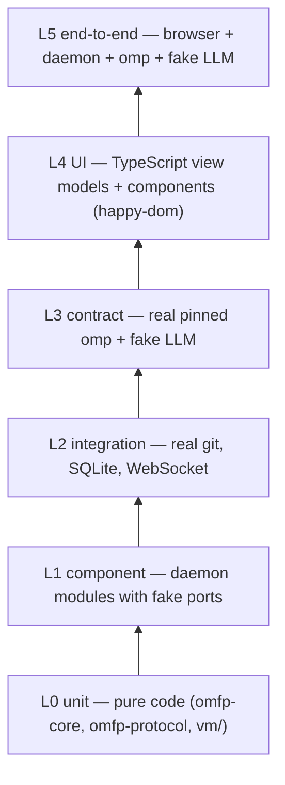

# 06 — Testing strategy (TDD)

Test-driven development is the default way of working, not an afterthought. Every requirement in these specs has an ID;
code exists because a test citing that ID asked for it.

## Process

1. **Pick a requirement** (or a bug). If it is ambiguous, fix the spec first.
2. **Red**: write the smallest test that expresses it, citing the ID (`// spec: DMN-021`). Run it and check it fails
   *for the expected reason* (assertion, not compile error or panic elsewhere).
3. **Green**: write the minimal code that passes it.
4. **Refactor** with the suite green. Remove duplication in code and tests.
5. Repeat until every acceptance criterion of the requirement is covered (happy path, boundaries, errors, transitions).

| ID | Rule |
| --- | --- |
| TST-001 | Every change that alters behavior MUST come with tests written first; a bug fix MUST start with a test that reproduces the bug. |
| TST-002 | Tests assert observable behavior (outputs, state transitions, frames on the wire, files on disk), never implementation details (private fields, call counts on internal helpers). |
| TST-003 | Tests MUST be deterministic and isolated: no sleeps (wait on conditions with timeouts), no real network beyond loopback, no real model calls, temporary directories only, port 0 for servers, injected clock and ID generators. |
| TST-004 | Every test layer below runs in parallel safely; tests needing a shared scarce resource use a nextest test group with a concurrency limit. |
| TST-005 | Mutation testing (`cargo-mutants`) is the quality gate for test strength on pure crates; coverage is a signal, not a goal. |

## Layers



| Layer | What | Tools | Runs in |
| --- | --- | --- | --- |
| L0 | Reducer (Rust and its TypeScript port), view-models, protocol (de)serialization, naming/slug rules, `ask` validation, ring buffer, state machines | `cargo nextest`, `proptest`, `insta`; `bun test` for TypeScript | `just test`, `just test-ts` |
| L1 | ThreadService, AgentSupervisor, WorktreeManager, interactions, idle reaper — against `FakeGit`, `FakeAgent` (scripted omp frames), `FakeClock`, `FakePty` | `tokio::test(start_paused = true)` | `just test` |
| L2 | Real `git` on temp repos, real SQLite file, real WebSocket server with a native protocol client | `omfp-testkit` | `just test` |
| L3 | Our assumptions about omp: real pinned `omp --mode rpc-ui` talking to `fake-llm` (`crates/*/tests/contract_*.rs`) | `omfp-testkit`, `fake-llm` | `just test-contract` |
| L4 | The TypeScript UI: view-model unit tests (`ui/packages/app/src/vm/`, no DOM) and component tests of the kit and the app rendered in happy-dom, queried by `data-testid` and role with Testing Library, plus normalized HTML snapshots; the client's transport suite against the test daemon | `bun test`, happy-dom (preloaded from `ui/test/dom.ts`), `@testing-library/react` + `user-event` | `just test-ts` |
| L5 | Critical user journeys on the web build | `thirtyfour` (WebDriver) + `chromedriver` + Chromium | `just test-e2e` |

| ID | Requirement |
| --- | --- |
| TST-010 | `omfp-core`'s reducer MUST have example tests for every event kind it handles, plus property tests. |
| TST-011 | Property tests MUST check at least: (a) rebuilding an assistant message from `messageUpdates: "delta"` events equals the `message_end` content for any generated message; (b) snapshot → serialize → deserialize → apply remaining events equals applying all events (PRT-021); (c) queue chips always equal the last `queue_update`. |
| TST-012 | Contract tests (L3) MUST record each scenario as a fixture file written with `just record-fixtures` and normalized so that re-recording only shows real changes (wall-clock and duration fields zeroed; random ids, UUIDs, session-file timestamps and temporary paths replaced). Two formats: raw omp stdout frames (`fixtures/omp/<version>/`, M0 smoke) and the daemon's reducer inputs, `omfp_core::ThreadEvent` as JSON lines (`fixtures/threads/<version>/`, recorded through the daemon's omp adapter). L0/L1/L4 tests replay the thread fixtures, so the whole stack is tested against real omp output without starting omp. `fixtures/states/<version>/` holds, per thread fixture, the Rust reducer's state after each event (`just gen-states`), which the TypeScript reducer must reproduce exactly (D-04). |
| TST-013 | Contract tests MUST fail fast with a clear message if `omp --version` differs from the pinned version (DMN-001). |
| TST-014 | L1 fakes MUST be driven by the same fixture format as TST-012, so a fake never invents frames omp does not send. |

## Fake LLM (`fake-llm`)

An OpenAI-compatible server (axum) that answers from a script, making omp runs deterministic.

- `GET /v1/models` lists the scripted model.
- `POST /v1/chat/completions` with `stream: true` answers with SSE chunks of the next script step.
- Each step: optional match on the request (substring in the last user message or tool result), then a reply made of
  text chunks, tool calls (`id`, `name`, JSON arguments), finish reason; optionally an HTTP error (429/500) or a delay to
  test retries and streaming.
- Every received request is recorded and exposed in-process (and at `GET /__requests`) for assertions.
- An unexpected request (script exhausted or no match) answers 500 and fails the test with the request body.

omp runs in an isolated environment (`omfp_testkit::OmpEnv`): its own `HOME`, agent directory (`PI_CODING_AGENT_DIR`,
see upstream `environment-variables.md`), XDG directories and working directory, with provider credentials removed
from the environment. The agent directory holds a `models.yml` with a custom provider (shape from upstream `models.md`):

```yaml
providers:
  fake:
    baseUrl: http://127.0.0.1:<port>/v1
    auth: none
    api: openai-completions
    models:
      - id: scripted
        name: Scripted
        reasoning: false
        input: [text]
        contextWindow: 128000
        maxTokens: 8192
```

and a `config.yml` setting `modelRoles.default: fake/scripted`; omp is launched with `--model fake/scripted`.

Spike S-02 found that omp always runs a background model-catalog discovery at startup: the shared catalog
(`catalog.stencil.so`) and the model lists of keyless providers. No setting turns it off entirely
(`disabledProviders` removes the keyless providers but not the shared catalog). Contract tests therefore run omp behind
`omfp_testkit::DenyProxy`, an HTTP(S) proxy set in `HTTP_PROXY`/`HTTPS_PROXY` (loopback excluded with `NO_PROXY`) that
refuses and records every connection. The discovery requests fail at once, so runs stay offline and deterministic.

| ID | Requirement |
| --- | --- |
| TST-020 | `fake-llm` itself is developed test-first: its own tests check SSE framing, tool-call chunking and request recording. |
| TST-021 | Contract tests MUST run omp behind the deny proxy and fail when omp tries to reach a host outside `omfp_testkit::KNOWN_DISCOVERY_HOSTS`. That list is reviewed on every omp upgrade. |

## UI testing

| ID | Requirement |
| --- | --- |
| TST-030 | Transport suite: the client's transport (the TypeScript client's WebSocket transport, the only one, UI-001) MUST pass hello, auth failure, subscribe/snapshot, replay and reconnect tests under `bun test` against a real daemon (`crates/omfp-daemon/examples/test_daemon.rs`, fake launcher and fake git, started by `just test-ts`). |
| TST-031 | Components get `data-testid` attributes for L4/L5 selectors; tests never select by CSS class or text that is likely to change. |
| TST-032 | HTML snapshots of the TypeScript component tests MUST be normalized (generated ids and timestamps stripped) so they only change when markup really changes. |
| TST-033 | The desktop build has a smoke test: start with `OMFP_SMOKE=1` under a virtual X server, connect to the in-process daemon, render the shell, exit 0. |

## End-to-end scenarios (L5)

Kept few and focused on journeys; everything else belongs to lower layers.

| ID | Scenario |
| --- | --- |
| E2E-01 | "+ workspace" with a repository's path typed with the path field's completion → a new workspace holding a link to it opens a draft thread → send the first message → the thread is created, the streamed reply renders (the agent's cwd is the workspace folder) → thread idle. |
| E2E-02 | Prompt triggers a tool needing approval → approve in UI → tool card completes. |
| E2E-03 | `ask` with two questions (single + multi) → answer → agent continues with the answers (checked on `fake-llm` recorded request). |
| E2E-04 | Reload the page mid-stream → transcript continues without gaps or duplicates. |
| E2E-05 | Queue a follow-up while busy → remove it → abort with queued steer → text restored in composer. Then `Ctrl-C`: type a draft → `Ctrl-C` clears it; queue a follow-up while busy → `Ctrl-C` twice → the turn is aborted, the queue and the composer are empty. |
| E2E-06 | Agent edits a file → Changes panel shows the diff. |
| E2E-07 | Open thread in `omp` terminal → `/exit` → back in app with history reloaded. |
| E2E-08 | In a workspace, link two repositories from two different places with the path field's completion → `/` search by either repository's name finds the thread. |
| E2E-09 | Workspace folders (D-11): link an external repo from the UI → it appears in the Workspace panel and the agent's next turn has its `AGENTS.md`; a scripted agent runs `git worktree add` and `ln -s` in the workspace → both appear live; remove the link → `/remove-dir` is sent and the repo disappears. |

## Traceability

| ID | Requirement |
| --- | --- |
| TST-040 | `cargo xtask spec-trace` MUST list every requirement ID in `docs/specs/*.md` and the sources citing it (`spec: <ID>` in Rust or TypeScript sources or the justfile; `target/`, `node_modules/` and hidden directories are skipped), and fail on IDs cited but missing from the specs. `docs/specs/milestones.toml` lists each milestone's requirements: once a milestone is marked `done`, any of them without a citation fails `just ci`. |

## Commands

| Command | Runs |
| --- | --- |
| `just test` | L0, L1, L2 (Rust) — fast, every change |
| `just test-contract` | L3 against the pinned omp (needs the dev shell) |
| `just test-ts` | `bun run test` in `ui/`: L0 TypeScript (the reducer against the golden states, client session/model tests), L4 (view models, kit and app component tests with the happy-dom preload), the client transport suite against the test daemon |
| `just gen-ts` / `just gen-states` | regenerate the TypeScript protocol types (`ui/packages/protocol/src/generated.ts`) / the golden reducer states (`fixtures/states/<version>/`); `just test` fails while either is stale |
| `just test-e2e` | L5 (builds the release web bundle first, `just build-web`) |
| `just mutants` | `cargo mutants` on `omfp-core`, `omfp-protocol`, `fake-llm`, `xtask` (`--in-diff` for changed code) |
| `just cov` | `cargo llvm-cov` report |
| `just ci` | everything above + `spec-trace`, `clippy -D warnings`, `fmt --check`, `cargo deny check` |

| ID | Requirement |
| --- | --- |
| TST-050 | Gates for `just ci`: no surviving mutants in `omfp-core` and `omfp-protocol` (exceptions listed with a reason in `mutants.toml`); line coverage ≥ 90% for `omfp-core`, `omfp-protocol` and the TypeScript view models (`ui/packages/app/src/vm/`, `bun test --coverage`), ≥ 75% for `omfp-daemon`. |
