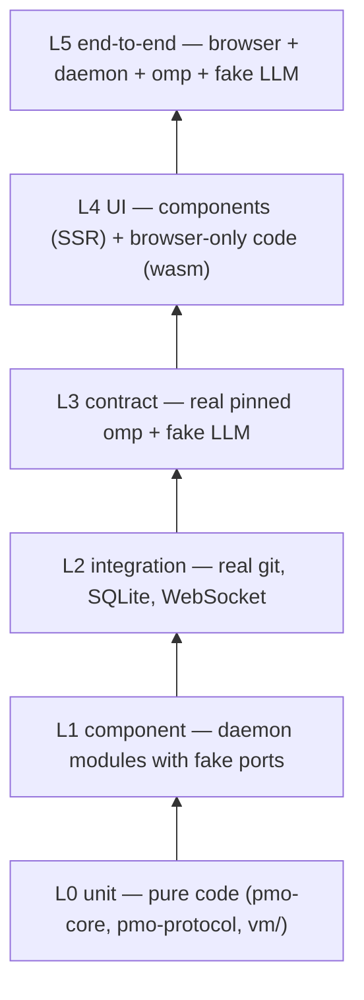

# 06 — Testing strategy (TDD)

Test-driven development is the default way of working, not an afterthought. Every requirement in these specs has an ID;
code exists because a test citing that ID asked for it.

## Process

1. **Pick a requirement** (or a bug). If it is ambiguous, fix the spec first.
2. **Red**: write the smallest test that expresses it, citing the ID (`// spec: DMN-021`). Run it and check it fails
   *for the expected reason* (assertion, not compile error or panic elsewhere).
3. **Green**: write the minimal code that passes it.
4. **Refactor** with the suite green. Remove duplication in code and tests.
5. Repeat until every acceptance criterion of the requirement is covered (happy path, boundaries, errors, transitions).

| ID | Rule |
| --- | --- |
| TST-001 | Every change that alters behavior MUST come with tests written first; a bug fix MUST start with a test that reproduces the bug. |
| TST-002 | Tests assert observable behavior (outputs, state transitions, frames on the wire, files on disk), never implementation details (private fields, call counts on internal helpers). |
| TST-003 | Tests MUST be deterministic and isolated: no sleeps (wait on conditions with timeouts), no real network beyond loopback, no real model calls, temporary directories only, port 0 for servers, injected clock and ID generators. |
| TST-004 | Every test layer below runs in parallel safely; tests needing a shared scarce resource use a nextest test group with a concurrency limit. |
| TST-005 | Mutation testing (`cargo-mutants`) is the quality gate for test strength on pure crates; coverage is a signal, not a goal. |

## Layers



| Layer | What | Tools | Runs in |
| --- | --- | --- | --- |
| L0 | Reducer, view-models, protocol (de)serialization, naming/slug rules, `ask` validation, ring buffer, state machines | `cargo nextest`, `proptest`, `insta` | `just test` |
| L1 | ThreadService, AgentSupervisor, WorktreeManager, interactions, idle reaper — against `FakeGit`, `FakeAgent` (scripted omp frames), `FakeClock`, `FakePty` | `tokio::test(start_paused = true)` | `just test` |
| L2 | Real `git` on temp repos, real SQLite file, real WebSocket server with a native protocol client | `pmo-testkit` | `just test` |
| L3 | Our assumptions about omp: real pinned `omp --mode rpc-ui` talking to `fake-llm` | `pmo-testkit`, `fake-llm` | `just test-contract` |
| L4 | Components rendered via `VirtualDom` + `dioxus-ssr`, asserted with selectors and HTML snapshots; browser-only code (web transport, xterm bridge) | `scraper`, `insta`, `wasm-bindgen-test` in headless Chromium | `just test`, `just test-wasm` |
| L5 | Critical user journeys on the web build | `thirtyfour` (WebDriver) + `chromedriver` + Chromium | `just test-e2e` |

| ID | Requirement |
| --- | --- |
| TST-010 | `pmo-core`'s reducer MUST have example tests for every event kind it handles, plus property tests. |
| TST-011 | Property tests MUST check at least: (a) rebuilding an assistant message from `messageUpdates: "delta"` events equals the `message_end` content for any generated message; (b) snapshot → serialize → deserialize → apply remaining events equals applying all events (PRT-021); (c) queue chips always equal the last `queue_update`. |
| TST-012 | Contract tests (L3) MUST record the raw omp frames of each scenario as fixture files (`fixtures/omp/<version>/<scenario>.jsonl`). L0/L1/L4 tests replay these fixtures, so the whole stack is tested against real omp output without starting omp. |
| TST-013 | Contract tests MUST fail fast with a clear message if `omp --version` differs from the pinned version (DMN-001). |
| TST-014 | L1 fakes MUST be driven by the same fixture format as TST-012, so a fake never invents frames omp does not send. |

## Fake LLM (`fake-llm`)

An OpenAI-compatible server (axum) that answers from a script, making omp runs deterministic.

- `GET /v1/models` lists the scripted model.
- `POST /v1/chat/completions` with `stream: true` answers with SSE chunks of the next script step.
- Each step: optional match on the request (substring in the last user message or tool result), then a reply made of
  text chunks, tool calls (`id`, `name`, JSON arguments), finish reason; optionally an HTTP error (429/500) or a delay to
  test retries and streaming.
- Every received request is recorded and exposed in-process (and at `GET /__requests`) for assertions.
- An unexpected request (script exhausted or no match) answers 500 and fails the test with the request body.

omp is pointed at it through an isolated agent directory (`PI_CODING_AGENT_DIR`, see upstream
`environment-variables.md`) containing a `models.yml` with a custom provider (shape from upstream `models.md`):

```yaml
providers:
  fake:
    baseUrl: http://127.0.0.1:<port>/v1
    auth: none
    api: openai-completions
    models:
      - id: scripted
        name: Scripted
        reasoning: false
        input: [text]
        contextWindow: 128000
        maxTokens: 8192
```

and launched with `--model fake/scripted`. Settings that would reach the network or add nondeterminism (model catalog
refresh, update checks, title generation, memory, advisor) MUST be disabled in that directory's `config.yml`
**[VERIFY in spike S-02: exact keys]**.

| ID | Requirement |
| --- | --- |
| TST-020 | `fake-llm` itself is developed test-first: its own tests check SSE framing, tool-call chunking and request recording. |
| TST-021 | A contract test MUST fail if omp makes any request to a host other than `fake-llm` during the run **[VERIFY in S-02 how to detect: e.g. `HTTP(S)_PROXY` pointing at a refusing proxy]**. |

## UI testing

| ID | Requirement |
| --- | --- |
| TST-030 | Transport suite: the same tests run against both `Transport` implementations (native in L2, web in `wasm-bindgen-test` against a daemon started by the test harness) — hello, auth failure, subscribe/snapshot, replay, reconnect (UI-001). |
| TST-031 | Components get `data-testid` attributes for L4/L5 selectors; tests never select by CSS class or text that is likely to change. |
| TST-032 | HTML snapshots MUST be normalized (generated ids and timestamps stripped) so they only change when markup really changes. |
| TST-033 | The desktop build has a smoke test: start with `PMO_SMOKE=1` under a virtual X server, connect to the in-process daemon, render the shell, exit 0. |

## End-to-end scenarios (L5)

Kept few and focused on journeys; everything else belongs to lower layers.

| ID | Scenario |
| --- | --- |
| E2E-01 | Create thread with a new worktree from a repository path → prompt → streamed reply rendered → thread idle. |
| E2E-02 | Prompt triggers a tool needing approval → approve in UI → tool card completes. |
| E2E-03 | `ask` with two questions (single + multi) → answer → agent continues with the answers (checked on `fake-llm` recorded request). |
| E2E-04 | Reload the page mid-stream → transcript continues without gaps or duplicates. |
| E2E-05 | Queue a follow-up while busy → remove it → abort with queued steer → text restored in composer. |
| E2E-06 | Agent edits a file → Changes panel shows the diff. |
| E2E-07 | Open thread in `omp` terminal → `/exit` → back in app with history reloaded. |
| E2E-08 | Create a thread with no workspace → attach two workspaces from two different repositories → group the thread list by repository: the thread appears under both. |

## Traceability

| ID | Requirement |
| --- | --- |
| TST-040 | `cargo xtask spec-trace` MUST list every requirement ID in `docs/specs/*.md` and the tests citing it (`spec: <ID>` in test source), and fail on IDs cited in tests but missing from specs. Requirements in a finished milestone with no test fail `just ci`. |

## Commands

| Command | Runs |
| --- | --- |
| `just test` | L0, L1, L2, L4 (SSR) — fast, every change |
| `just test-contract` | L3 against the pinned omp (needs the dev shell) |
| `just test-wasm` | `wasm-bindgen-test` in headless Chromium |
| `just test-e2e` | L5 (builds the web bundle first) |
| `just mutants` | `cargo mutants` on `pmo-core`, `pmo-protocol`, `pmo-ui/vm` (`--in-diff` for changed code) |
| `just cov` | `cargo llvm-cov` report |
| `just ci` | everything above + `spec-trace`, `clippy -D warnings`, `fmt --check`, `cargo deny check` |

| ID | Requirement |
| --- | --- |
| TST-050 | Gates for `just ci`: no surviving mutants in `pmo-core` and `pmo-protocol` (exceptions listed with a reason in `mutants.toml`); line coverage ≥ 90% for `pmo-core`, `pmo-protocol`, `pmo-ui/vm`, ≥ 75% for `pmo-daemon`. |
