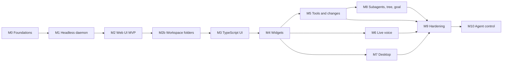

# 07 — Roadmap

Each milestone ends when its acceptance criteria pass in `just ci` and every requirement ID in its scope is traced to a
test (TST-040). Spikes are time-boxed experiments whose outcome updates the specs; their code is thrown away or turned
into tests.

## Spikes

| ID | Question | Outcome feeds | Result |
| --- | --- | --- | --- |
| S-01 | Does `omp-rpc` (tag of the pinned omp) compile for `wasm32-unknown-unknown`? If not: fork with an optional `client` feature, or vendor the generated `wire.rs` with a script that copies it from the tag. | ARC-011 | **Done (M0):** compiles as-is; `omfp-core` depends on it directly. |
| S-02 | omp against `fake-llm`: custom `openai-completions` provider streams text and tool calls; which `config.yml` keys make a run offline and deterministic (catalog refresh, update check, title, memory, advisor); how to detect stray network access. | TST-020/021, 06 fake LLM section | **Done (M0):** text round trip works; background catalog discovery cannot be disabled, so tests run behind a deny proxy with a list of known discovery hosts (06). |
| S-03 | Code highlighting in the web bundle and the desktop webview: candidate libraries, bundle size and speed on a 5k-line file. | UI-090 | **Done (M5):** highlight.js 11.12 core through lowlight 3.3, each grammar a lazily `import()`ed chunk, `hljs-*` classes colored by the theme's role tokens in kit.css (light, dark, matugen and hand-written themes apply without rebuilding), tokens rendered as React elements (no `dangerouslySetInnerHTML`), Markdown fences through react-markdown's `code` component (not `rehype-highlight`, which bundles 37 grammars). Measured (Bun 1.4.4 minify + splitting, gzip): lowlight 10 KiB in the main chunk, 0.3–4 KiB per grammar, 40 KiB for 30 languages; Shiki 4.6 (JavaScript regex engine, CSS-variables theme) 56 KiB core, 1–40 KiB per grammar (ruby 182 KiB), 313 KiB for 30. On a 5k-line TypeScript file lowlight takes 44 ms in Chromium 157 and 51 ms in WebKitGTK 2.54, Shiki 242 ms and 1.7 s; hast → React 5 ms vs 108 ms. Shiki's finer TextMate scopes collapse onto our ~12 role colors anyway. The app bundle was 276 KiB gzip of the 3 MiB budget before M5. |
| S-04 | Tauri 2 desktop on NixOS in the dev shell: window opens (webkitgtk), the web bundle connects to the local daemon, xterm.js works in the webview. | UI-001, TRM-021 | |
| S-05 | `dx` 0.7.10 + nixpkgs `wasm-bindgen-cli` 0.2.130: pin `wasm-bindgen = "=0.2.130"` in the workspace and check `dx build --platform web` uses the shell's binary without downloading another. | 01 | **Done (M0):** `dx build -p omfp-ui --platform web` uses the shell's wasm-bindgen; nothing downloaded. dx 0.7.10 panics on glob `default-members`, so the workspace sets none. |
| S-06 | Transcript virtualization in Dioxus with variable-height items, streaming at the bottom. | UI-042 | **Done (M2):** in headless Chromium 157 a 10,000-message transcript keeps 7–13 items (≈150–400 nodes) in the DOM: unmeasured items count as 120 px, measured heights come from `onresize` per item, two spacers stand for the rest. Bottom pinning holds through streaming; only user scrolling (wheel up, ArrowUp/PageUp/Home, pointer or touch drag) unpins — layout-driven scroll events must not, or the bottom is lost while streaming — and reaching the bottom pins again. The container exposes `data-pinned`. |
| S-07 | Multi-workspace threads: `/add-dir` and `/remove-dir` over RPC (idle and busy); repo-level context files (`AGENTS.md`) and rules picked up from `--add-dir` roots when cwd is the thread home; injecting a per-thread MCP server through `<home>/.omp/mcp.json` (08). | DMN-029, DMN-030, 08 | **Done (M1):** `/add-dir` over RPC is a local command (no model turn) that adds the root live; `AGENTS.md` of every `--add-dir` root reaches the model, but only when the session is bound at launch (`--session-dir … --continue`, DMN-030); `<home>/.omp/mcp.json` is honored and its headers are sent. `/add-dir` while the thread is busy is still unverified against real omp (DMN-029). |
| S-08 | Workspaces from PRs: fetching a PR head (GitHub via `gh`, generic `refs/pull/N/head`), storing PR metadata, detecting merged/closed PRs. | DMN-024 | **Postponed** with PR repositories (M5 scope check, see "Later"). |
| S-09 | Live voice through omp's `live_connect`: a WebRTC peer (Opus sendrecv track + `oai-events` data channel) in Chromium and in the desktop webview (webkitgtk), SDP relayed by the daemon; secure-context requirements for the microphone. | M9 | |
| S-10 | Workspace folders (D-11 revised): cwd = a non-git folder whose top-level entries are repos (real clones and symlinks to external repos); context files, roots, tools through symlinks, `--append-system-prompt`, `--config` overlays. | D-11, DMN-022..030 | **Done:** without `--add-dir` omp shows nothing about child repos (no context files, no roots); with `--add-dir <ws>/<name>` (symlink path) their `AGENTS.md` load and `<workspace-roots>` lists them under the symlink path, live `/add-dir` too; omp never resolves the symlink. `read`/`write`/`bash` through a symlink work and change the external target; no path refusal. Roots saved in a session are merged with the flags on `--continue`: dropping a flag does not detach, `/remove-dir` does. `--append-system-prompt` lands verbatim at the very end of the prompt and disables every `APPEND_SYSTEM.md` (user, cwd `.omp/`; a repo's `.omp/APPEND_SYSTEM.md` is never read). A `--config` overlay with `workspace.additionalDirectories` equals `--add-dir`. A non-git cwd causes no warning. Tests: `crates/omfp-daemon/tests/contract_workspace_folder.rs`. |
| S-11 | Preact + `preact/compat` with React Aria Components: dialog (focus trap), menu, popover, combobox (`/` commands), tabs, listbox, virtualized list; keyboard, focus and portal event behaviour in Chromium and WebKitGTK; bundle size and streaming render cost vs React 19 on the same screens. | D-18, UI-092, UI-093 | **Done (M3):** React 19 chosen. Preact 10 crashes in React Aria's collection document (global `document` for DOM nodes); Preact 11 passes every check only with three workarounds on React Aria internals (missing `createElementNS`/`remove()` in its collection document, `{...e}` losing native keyboard event fields, effect cleanups after paint leaving the trigger `inert` on focus restore) and events inside portals do not bubble to JSX ancestors. React 19 passes every keyboard, focus, portal, `/` completion and virtualized-transcript check in headless Chromium 157 and WebKitGTK 2.54 (WebKitWebDriver + MiniBrowser under xvfb-run) with no workaround. Sizes (gzip): React 19 145 KB vs Preact 11 87 KB. Streaming 100 updates/s for 10 s: both 600 frames without long tasks; React uses 1.5–4× more script time, still with headroom. WebKitGTK does not scroll a focused container on PageUp: the transcript must handle PageUp/PageDown/Home/End itself. `bun build` needs no Node. |
| S-12 | Loading agent widgets (M4): the daemon serves `<workspace>/.omfp/widgets/<name>/` as ES modules — TSX transpiled in Rust with `oxc` vs buildless `htm` modules —; one shared React through an import map; hot reload; errors in place. | M4, 08 | **Done:** both strategies pass all 17 checks in headless Chromium 157 and WebKitGTK 2.54 (import map with dynamic `import()`, one React instance with hooks and context shared, reload when a relative import changes, syntax/render/top-level/bad-import errors shown in place and recovered on the next save). Chosen: **oxc** (`=0.158.0` pinned: weekly breaking releases) for `.ts/.tsx/.jsx` with JSX via `react/jsx-runtime`, cached by mtime+size, ~0.15 ms per 200-line widget, compile errors as a stand-in module that renders line/column and exports `compileError`; `.js` (e.g. `htm`) served as-is by the same route. Cost: +3 MB stripped binary, 59 new crates, licences allowed. URLs carry a version hash (`/widgets/<name>/<version>/<file>`), not `?v=`, so relative imports and failed imports reload reliably; state kept outside the module (`useStored`) survives reloads, component-local state does not (React Refresh not tried). Reload after a push renders in under 20 ms; the 1 s poll dominates for edits outside agent tool calls. TypeScript elides unused-as-value imports, so a wrong kit import surfaces as an undefined variable unless imports are checked against the kit/sdk exports. |

## M0 — Foundations (done)

Scope: Cargo workspace with all crates as empty shells; `justfile`; `cargo xtask spec-trace`; `fake-llm` minimal;
`omfp-testkit` with temp git repos and isolated omp agent dir; spikes S-01, S-02, S-05.

Acceptance:

- `just ci` is green in the dev shell (with empty-but-compiling crates).
- `omfp-core` and `omfp-protocol` build for `wasm32-unknown-unknown`.
- Version test: the omp tag in `flake.lock`, the `omp-rpc` git tag in `Cargo.toml`, and `omp --version` agree (ENV-010).
- Contract test "hello": omp `rpc-ui` + `fake-llm` answers a prompt with scripted text; frames recorded as fixture.

Requirements traced for this milestone are listed in `milestones.toml`.

## M1 — Headless daemon (done)

Scope: DMN-001..072 except host tools beyond `open_in_editor` and PR workspaces (DMN-022, after S-08); PRT-001..034;
JSON Schemas for protocol methods (AGT-007); ThreadState reducer for messages, tools, queue, process state, interactions;
spike S-07; the single `omfp` binary with the `daemon` subcommand (D-15). At the end of M1 the project is renamed to
**omfp** (crates, binary, docs).

Acceptance:

- A native protocol client (test) creates two managed workspaces in two different repositories, creates one thread on
  both (cwd = thread home, one `--add-dir` per workspace), prompts, and receives streamed events that the reducer turns into the
  expected transcript; attaching a third workspace live sends `/add-dir`.
- Approval and `ask` round trip through the protocol (contract scenario with approval mode `always-ask`).
- Disconnect mid-stream and resubscribe with `since` → replay with no gaps; with an evicted position → snapshot that
  equals the daemon's state.
- Process crash → `Failed` with stderr tail; next prompt restarts and history reloads.
- Idle reaper stops an unwatched settled thread (L1 with paused time).

Result: all acceptance scenarios pass as L3 contract tests against real omp 18.18.6 (`crates/omfp-daemon/tests/
contract_daemon.rs`), the supervisor runs L1 tests on a fake launcher replaying the recorded fixtures with paused time,
and the server runs L2 tests with a native WebSocket client. `omfp daemon` serves `system.hello` and publishes
`daemon.json`. Known limits from omp-rpc 18.18.6: no exit code on crash (DMN-035), no drain window on shutdown
(DMN-005), prompt ids unique per process epoch (PRT-030). Open: `/add-dir` on a busy thread (S-07), PR workspaces
(S-08), `terminal.*`.

## M2 — Web UI MVP (done)

Scope: UI-001..003, UI-010..012, UI-020..025, UI-030, UI-040..043, UI-050 (fallback card only), UI-060..064,
UI-070..073, UI-091..092; daemon serves the web bundle.

Acceptance: E2E-01, E2E-02, E2E-03, E2E-04, E2E-05, E2E-08 pass.

Result: the journeys run in `e2e/` (L5: headless Chromium, in-process daemon serving the release bundle, real omp
18.18.6, fake LLM), next to the transport suite in Chromium (`just test-wasm`); both are part of `just ci`. `just serve`
builds the bundle and runs the daemon with the user's own omp configuration. The protocol client lives in its own crate
(`omfp-client`); every method's result is decoded into its declared type by L2 tests and, for the methods forwarded to
omp that the UI uses, by an L3 test. Known gaps: no browser test for the countdown ticking (UI-073); "answered
elsewhere" covers only what happened while watching live; adding a pull request waits for
S-08.

## M2b — Workspace folders (done: daemon and protocol)

Scope: the revised D-11 — DMN-020..030 (workspace folders, discovered repositories, add/remove repo, rescan, root sync,
launch with `--append-system-prompt`), ARC-008, the protocol methods of 03 for workspaces and `threads.create`, UI-020,
UI-022, UI-023, UI-025, UI-030; migration 3 (each existing thread gets a new owned workspace folder holding symlinks to
the directories of its old workspaces, old managed worktrees stay where they are).

Acceptance: E2E-09 (create a thread in a new workspace → link an external repo from the UI → the repo appears in the
Workspace panel and the agent's next turn has its `AGENTS.md`; a scripted agent runs `git worktree add` and `ln -s` in
the workspace → both appear live; remove the link → `/remove-dir` sent and the repo disappears); L1 tests for scanning
with `FakeGit`; L3 test that a launch carries the user's `APPEND_SYSTEM.md` after the daemon's text.

M2b's UI part (UI-020..030 under the new model, E2E-09) is delivered by M3 on the new stack (D-18); M2b closes with the
daemon, protocol and their tests.

Result: migration 3 moves every thread into its own new workspace folder holding links to its old directories (L2 test
on a database built with migrations 1+2; L3 test that omp resumes a session with its history after the cwd changes).
omp starts in the workspace with one `--add-dir` per repo and the conventions text plus the user's `APPEND_SYSTEM.md`
(`conventions.rs`); rescans run at startup, after workspace methods and after every finished tool run; omp refuses
`/add-dir` and `/remove-dir` while streaming, so a busy thread's root sync waits until it settles (DMN-029). Hidden
entries are not repositories (DMN-022). The Dioxus UI got only the minimal changes; E2E-09 moves to M3.

## M3 — TypeScript UI (done)

Scope (D-18): replace the Dioxus UI and `omfp-client` with a TypeScript web app — React 19 with React Aria Components (S-11), Bun for bundling and tests, no
Node toolchain; TypeScript protocol types generated from the JSON Schemas (AGT-007) and checked in CI; a TypeScript
client (transport, session with replay/snapshot/resync and backoff, model) passing the transport suite against a real
daemon (TST-030); the reducer ported to TypeScript and checked against golden states produced by the Rust reducer for
every fixture (D-04); parity with M2 (every UI-0xx row M2 covered) plus the workspace-folder UI of M2b. The `omfp`
binary stays in Rust and embeds or serves the bundle (DMN-008).

Acceptance: E2E-01..05, E2E-08, E2E-09 pass on the new UI (the L5 harness stays in Rust); component tests for the
shell; the Dioxus crate and `omfp-client` are deleted.

Progress (framework-agnostic foundation): `ui/` is a Bun workspace (strict `tsc`, Biome, `bun test`; dependencies from
`ui/bun.lock`, see ENV-001) with `@omfp/protocol` (types and the method table generated from the daemon's JSON
Schemas by `just gen-ts`, plus the envelope and topics), `@omfp/core` (the reducer port, reproducing the Rust
reducer's state after every event of every thread fixture, `fixtures/states/<version>/`, `just gen-states`) and
`@omfp/client` (WebSocket transport, session, model; the transport suite runs against the test daemon in
`just test-ts`). `just test` fails while the generated types or the golden states are stale.

Result: `ui/packages/kit` (`@omfp/kit`: React Aria wrappers styled only by token CSS, built-in light/dark tokens in a
cascade layer so a user theme always wins, Markdown through react-markdown without raw HTML) and `ui/packages/app`
(`@omfp/app`): a frame (connection banner, view switcher, keymap with vim defaults and the `:` command line, safety
net for pending interactions, notifications, live region) around one default **view** — a layout tree of
`row`/`col`/`tabs`/`stack` in the `views.json` shape of M4 — rendered from a widget registry under error boundaries:
`omfp:threads`, `omfp:header`, `omfp:workspace`, `omfp:chat` (`omfp:transcript`, `omfp:interactions`,
`omfp:composer`). Widgets read state only through the SDK hooks of `ui/packages/app/src/sdk` (the seed of M4's
`omfp/sdk`); model changes reach React as one snapshot per animation frame (UI-012). The daemon keeps the global theme
(`theme.get`/`theme.set`, `/theme.css`, the watched `$XDG_CONFIG_HOME/omfp/theme.css`, `omfp theme set`,
`contrib/matugen/`), the config file with the UI settings (DMN-009, UI-097), generates thread titles with one omp
print-mode run (`omp -p --no-session --no-tools --no-title … --model @smol`, DMN-073) and defaults new threads to
`yolo` (DMN-074); the agent renames its thread with the `set_thread_title` host tool. The `omfp` binary moved to
`crates/omfp`; `omfp-ui` (Dioxus) and `omfp-client` are deleted with their pins (ENV-012 retired). `just build-web`
bundles with `bun build` into `ui/packages/app/dist`; E2E-01..05, 08, 09 and journeys for the keymap and a live theme
change pass in headless Chromium. Known gaps: the dialog focus trap's backward wrap is checked only in browsers
(happy-dom does not wrap Shift+Tab); pull-request grouping and repositories wait for S-08.

## M4 — Widgets (agent-made UI, from 08) (done)

Scope: D-17's UI part brought forward, as designed in [08](08-agent-control.md#agent-made-ui-views-and-widgets-m4): a
**views manifest** per workspace (`.omfp/views.json`: several views, each a layout tree of `row`/`col`/`tabs`/`stack`
with widget references and props), edited by the agent as a file and by the user from the UI; **widgets** as React
components (built-in `omfp:*`, workspace `./widgets/<name>`, user library `user:<name>`) running in the window under
error boundaries, with the SDK as hooks (full protocol, tool-run output, daemon jobs, storage) and the shell's kit and
theme; the daemon serves and transpiles workspace widgets and pushes changes found on rescan and poll. The
conversation is a widget (`omfp:chat`: transcript, interactions, queue, composer, with its parts), as are the header
and the workspace panel, all copyable; only a thin frame (left column, connection, view switcher, keymap and command
line, and a safety net that shows pending interactions no widget renders) stays outside the manifest. Agents learn it
from the daemon's `--append-system-prompt` note, `omfp://docs/widgets` and the manifest schema. Spike S-12 first.
Requirements: AGT-010..025, DMN-062, DMN-080..087, PRT-040..042, UI-100..106, E2E-10..12. Not in M4 (08, "Later"):
`useAgent`, `useFile`/`workspaces.read_file`, the widget-state and job host tools, `:widget save`, dashboards and
windows outside the workspace view; `omfp:changes` is M5.

Acceptance: a scripted agent writes a widget that charts test results from a daemon job and adds it to a view in
`views.json` → it appears live; an invalid manifest shows the default view and the error; the user moves and hides
widgets and `views.json` changes; a built-in widget copied into the workspace and modified replaces the original there;
two views switch from the shell.

Result: E2E-10..12 pass in headless Chromium against real omp and the fake LLM — a scripted agent writes
`.omfp/widgets/tests/index.tsx` (a progress bar over a daemon job via `useJob`) and adds it to `views.json`, and it
appears and advances live; an invalid manifest shows the default view and a banner, and fixing the file recovers; layout
editing (Move menu, hide, add from a picker, resize) writes `views.json`; `:widget copy` copies a built-in into the
workspace where it replaces the original; a syntax error shows in place and recovers. Widgets are compiled by oxc
`=0.158.0` with imports checked against the real `omfp/sdk` / `omfp/kit` exports and served under a per-start key
handed out in `system.hello` (D-19). omp 18.18.6 streams partial `bash` output, so `useToolRun` is live. Left out by the
scope check (08 lists them as later): `useAgent`, `useFile`, the agent's job and widget-state host tools, `jobs.list`,
`:widget save`, pointer drag, dashboards outside the workspace view.

## M5 — Tools and changes (done)

Scope: specialized tool cards in the transcript (UI-050..052) from recorded fixtures — `bash`, `read`, `edit`/`write`,
`grep`/`glob`/`find`/`ast_grep`, `todo`, `web_search`/`fetch`, `ask`, `task` (subagent name, task and live progress;
the subagent panel it would link to is M8); the **`omfp:changes`** widget (UI-080, DMN-026): per repository of the
current workspace, changed files with +/− counts and a diff view, in the default view as a tab next to
`omfp:workspace`; code highlighting (UI-090, after S-03) in Markdown code blocks, the diff view and tool results whose
language is known.

Moved out by the scope check:

- PR repositories (DMN-024 `pr`, S-08) → "Later": worktrees and similar are the agent's job, the agent can run
  `gh pr checkout` or `git fetch origin pull/N/head` itself, and GitHub cannot be tested offline; pending a user
  decision.
- `open_in_editor` (DMN-060/061) → M7: it is only useful from a desktop window on the daemon's machine; without the
  desktop it can only return an error.

Acceptance: E2E-06 (the agent edits a file → `omfp:changes` shows the diff); every specialized card has
fixture-driven tests for success, error and streaming states; highlighting follows the theme (light, dark, a custom
theme).

Result: nine contract scenarios (`crates/omfp-daemon/tests/contract_tool_cards.rs`) record the shapes of `read` (file,
directory, URL), `edit` (hashline input, omp's diff), `write`, `grep`, `glob`, a failing `bash` (exit code in
`details.exitCode`), `todo`, `web_search` (a SearXNG endpoint on loopback), `task` (a blocking subagent run with its
progress frames) and a cancelled `ask`; omp 18.18.6 offers no `find`, `ast_grep` or `fetch` tool (a URL is fetched with
`read`), so those keep the fallback card. Each specialized card (`ui/packages/app/src/vm/tool-view.ts`,
`widgets/chat/tool-cards.tsx`) is tested in its streaming, success and error states from those fixtures; `web_search`
engine failures and URL reads that could not be fetched end with `isError: false` in omp, so the cards read
`details.error` / `details.method` and show them as failed. `omfp:changes` follows the `workspace/<id>` topic and asks
`workspaces.status` (which rescans and republishes) after each `edit`/`write`/`bash` end of the selected thread and from
its refresh button; the kit gained `Diff`, `Code`'s `language` and `languageOfPath`. Highlighting is lowlight (S-03) in
Markdown fences, diffs and tool results with a known language. E2E-06 (a scripted agent rewrites a tracked file → the
Workspace tab shows the repository dirty, the Changes tab shows `+1 −0` and the diff) also checks that keywords take the
theme's primary color in light, dark and a custom theme. A tool run's end also refreshes `workspace/<id>`'s git status
(DMN-023): an edit of a tracked file is invisible to the poll's cheap check. Specialized card headers leave the
arguments their subject shows (and a `write`'s content) out of the argument summary. Known gaps: the `write` card shows
the written content, not a diff (omp sends no old text); the edit card
is covered by fixtures, but the journey edits with `write` because a hashline `edit` needs the file's tag from a
`read`; grep results list file paths as text (opening them waits for `open_in_editor`, M7).

## M6 — Live voice

omp 18.18.6 exposes its `/live` realtime voice over RPC (`docs/rpc.md` → "Live Voice Sub-Protocol"): the realtime
model talks with the user and delegates work into the thread as ordinary turns. `live_connect` takes a WebRTC SDP offer
from the client's own peer, so audio stays in the browser or desktop webview (works with a remote daemon), while
`live_start` would use the daemon machine's microphone. Draft-only dictation (`dictation_*`) uses the daemon machine's
microphone only.

Scope: spike S-09 first (WebRTC `live_connect` from Chromium and from the desktop webview; `getUserMedia` needs a
secure context: `localhost`/`127.0.0.1` or HTTPS through the deployer's proxy); protocol methods `thread.live_connect`
/ `.live_stop` / `.live_mute`; reducer state for `live_phase` and `live_transcript` (levels are client-side for
`live_connect`); UI: mic button in the composer, phase indicator, live transcript, mute and stop, stop on peer
disconnect; one live session per thread (omp allows one per process).

Acceptance: tests for the command plumbing and frames (the realtime model itself cannot be faked offline, so the
contract test covers the failure path and frame decoding); a manual check with a real OpenAI realtime key, recorded in
the spike result.

## M7 — Desktop

Scope: ARC-003, DMN-004, UI-004, UI-005, TST-033, `omfp desktop` with Tauri 2 (D-18): finds or starts the local daemon
in the background and opens one more window on it (D-15/D-16), or with `--connect <url>` opens a window on a remote daemon; watches the client-side theme file and pushes it (UI-091); spike S-04 (Tauri on NixOS, webkitgtk) first;
`open_in_editor` (DMN-060/061: `$VISUAL`/`$EDITOR` from a desktop window on the daemon's machine, a clear error from
the web; moved from M5, where it could only have been an error).

Acceptance: desktop smoke test passes under `xvfb-run`; a second `omfp desktop` opens another window on the same daemon,
each window selecting a different thread; a browser attaches to the same daemon and sees the same threads.

## M8 — Subagents, tree, goal

Scope: UI-081..083 (as built-in widgets); daemon commands for subagents, tree, fork, label, goal, btw, compact; reducer
support for subagent progress frames and goal updates.

Acceptance: contract scenarios for a `task` tool spawning a subagent (scripted), fork from an entry, navigate with
`editorText` restored; tests for each widget.

## M9 — Hardening

Scope:

- `Origin` allow-list configuration for deployments behind a tunnel or reverse proxy (D-13).
- Performance: 10k-message transcript stays responsive (S-06); streaming at 100 events/s without dropped frames.
- Coverage and mutation gates enforced (TST-050).
- CI on Nix (GitHub Actions or similar) running `just ci`.
- omp upgrade playbook rehearsed once on a real release (ENV-020).

Acceptance: all of the above documented and green in CI.

## M10 — Agent control

Scope: the rest of [08](08-agent-control.md) (D-17): every protocol method as an agent tool, plus `omfp_call`, through
the tool registry adapters (RPC host tools, `omfp://` host URIs, MCP server); widgets mounted by agents in dashboards and
windows beyond the workspace layout; the component library shared across workspaces with save, list and "save as
component"; full access by default; provenance, cascade stop and an activity log of agent-originated actions; limits
opt-in.

Acceptance: an orchestrating thread (scripted with `fake-llm`) creates two workspaces, spawns two threads, waits for
both, and mounts a dashboard widget that shows both threads' live state and has a button whose click reaches the
orchestrator; the same tools work over MCP from an omp session outside omfp.

## Terminal (deferred)

Not planned for now (D-06 revised): the user does not rely on the TUI-only commands. [05](05-terminal.md) stays as the
design to pick up if a real need appears (TUI-only features, or a shell panel per workspace). Scope when resumed:
TRM-001..022. Acceptance: E2E-07; L2 tests for PTY spawn, replay buffer, resize, channel isolation (TRM-012); handoff
refused while `Busy` (TRM-001).

## Later (noted, not scheduled)

- Helix-style modal editing in the composer (UI-095 keeps a keymap with modes, so it fits later).
- Configurable fonts, keymap and density from a settings file (the tokens and the keymap are data from M3).
- Terminal widget over PTY jobs (see "Terminal (deferred)").
- PR repositories (DMN-024 `pr`, spike S-08; moved out of M5): fetching a PR head into a worktree and tracking the PR.
  The agent can already do it with `gh pr checkout` or `git fetch origin pull/N/head`, and GitHub cannot be tested
  offline; waiting for a user decision.
