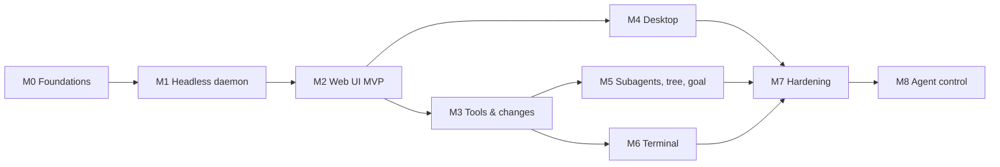

# 07 — Roadmap

Each milestone ends when its acceptance criteria pass in `just ci` and every requirement ID in its scope is traced to a
test (TST-040). Spikes are time-boxed experiments whose outcome updates the specs; their code is thrown away or turned
into tests.

## Spikes

| ID | Question | Outcome feeds | Result |
| --- | --- | --- | --- |
| S-01 | Does `omp-rpc` (tag of the pinned omp) compile for `wasm32-unknown-unknown`? If not: fork with an optional `client` feature, or vendor the generated `wire.rs` with a script that copies it from the tag. | ARC-011 | **Done (M0):** compiles as-is; `omfp-core` depends on it directly. |
| S-02 | omp against `fake-llm`: custom `openai-completions` provider streams text and tool calls; which `config.yml` keys make a run offline and deterministic (catalog refresh, update check, title, memory, advisor); how to detect stray network access. | TST-020/021, 06 fake LLM section | **Done (M0):** text round trip works; background catalog discovery cannot be disabled, so tests run behind a deny proxy with a list of known discovery hosts (06). |
| S-03 | Code highlighting on wasm and desktop: candidate libraries, wasm size and speed on a 5k-line file. | UI-090 | |
| S-04 | Dioxus 0.7 desktop on NixOS in the dev shell: window opens (webkitgtk), native WebSocket client, `document::eval` bridge with xterm.js on both platforms. | UI-001, TRM-021 | |
| S-05 | `dx` 0.7.10 + nixpkgs `wasm-bindgen-cli` 0.2.130: pin `wasm-bindgen = "=0.2.130"` in the workspace and check `dx build --platform web` uses the shell's binary without downloading another. | 01 | **Done (M0):** `dx build -p omfp-ui --platform web` uses the shell's wasm-bindgen; nothing downloaded. dx 0.7.10 panics on glob `default-members`, so the workspace sets none. |
| S-06 | Transcript virtualization in Dioxus with variable-height items, streaming at the bottom. | UI-042 | **Done (M2):** in headless Chromium 157 a 10,000-message transcript keeps 7–13 items (≈150–400 nodes) in the DOM: unmeasured items count as 120 px, measured heights come from `onresize` per item, two spacers stand for the rest. Bottom pinning holds through streaming; only user scrolling (wheel up, ArrowUp/PageUp/Home, pointer or touch drag) unpins — layout-driven scroll events must not, or the bottom is lost while streaming — and reaching the bottom pins again. The container exposes `data-pinned`. |
| S-07 | Multi-workspace threads: `/add-dir` and `/remove-dir` over RPC (idle and busy); repo-level context files (`AGENTS.md`) and rules picked up from `--add-dir` roots when cwd is the thread home; injecting a per-thread MCP server through `<home>/.omp/mcp.json` (08). | DMN-029, DMN-030, 08 | **Done (M1):** `/add-dir` over RPC is a local command (no model turn) that adds the root live; `AGENTS.md` of every `--add-dir` root reaches the model, but only when the session is bound at launch (`--session-dir … --continue`, DMN-030); `<home>/.omp/mcp.json` is honored and its headers are sent. `/add-dir` while the thread is busy is still unverified against real omp (DMN-029). |
| S-08 | Workspaces from PRs: fetching a PR head (GitHub via `gh`, generic `refs/pull/N/head`), storing PR metadata, detecting merged/closed PRs. | DMN-022 | |

## M0 — Foundations (done)

Scope: Cargo workspace with all crates as empty shells; `justfile`; `cargo xtask spec-trace`; `fake-llm` minimal;
`omfp-testkit` with temp git repos and isolated omp agent dir; spikes S-01, S-02, S-05.

Acceptance:

- `just ci` is green in the dev shell (with empty-but-compiling crates).
- `omfp-core` and `omfp-protocol` build for `wasm32-unknown-unknown`.
- Version test: the omp tag in `flake.lock`, the `omp-rpc` git tag in `Cargo.toml`, and `omp --version` agree (ENV-010).
- Contract test "hello": omp `rpc-ui` + `fake-llm` answers a prompt with scripted text; frames recorded as fixture.

Requirements traced for this milestone are listed in `milestones.toml`.

## M1 — Headless daemon (done)

Scope: DMN-001..072 except host tools beyond `open_in_editor` and PR workspaces (DMN-022, after S-08); PRT-001..034;
JSON Schemas for protocol methods (AGT-007); ThreadState reducer for messages, tools, queue, process state, interactions;
spike S-07; the single `omfp` binary with the `daemon` subcommand (D-15). At the end of M1 the project is renamed to
**omfp** (crates, binary, docs).

Acceptance:

- A native protocol client (test) creates two managed workspaces in two different repositories, creates one thread on
  both (cwd = thread home, one `--add-dir` per workspace), prompts, and receives streamed events that the reducer turns into the
  expected transcript; attaching a third workspace live sends `/add-dir`.
- Approval and `ask` round trip through the protocol (contract scenario with approval mode `always-ask`).
- Disconnect mid-stream and resubscribe with `since` → replay with no gaps; with an evicted position → snapshot that
  equals the daemon's state.
- Process crash → `Failed` with stderr tail; next prompt restarts and history reloads.
- Idle reaper stops an unwatched settled thread (L1 with paused time).

Result: all acceptance scenarios pass as L3 contract tests against real omp 18.18.6 (`crates/omfp-daemon/tests/
contract_daemon.rs`), the supervisor runs L1 tests on a fake launcher replaying the recorded fixtures with paused time,
and the server runs L2 tests with a native WebSocket client. `omfp daemon` serves `system.hello` and publishes
`daemon.json`. Known limits from omp-rpc 18.18.6: no exit code on crash (DMN-035), no drain window on shutdown
(DMN-005), prompt ids unique per process epoch (PRT-030). Open: `/add-dir` on a busy thread (S-07), PR workspaces
(S-08), `terminal.*`.

## M2 — Web UI MVP (done)

Scope: UI-001..003, UI-010..012, UI-020..025, UI-030, UI-040..043, UI-050 (fallback card only), UI-060..064,
UI-070..073, UI-091..092; daemon serves the web bundle.

Acceptance: E2E-01, E2E-02, E2E-03, E2E-04, E2E-05, E2E-08 pass.

Result: the journeys run in `e2e/` (L5: headless Chromium, in-process daemon serving the release bundle, real omp
18.18.6, fake LLM), next to the transport suite in Chromium (`just test-wasm`); both are part of `just ci`. `just serve`
builds the bundle and runs the daemon with the user's own omp configuration. The protocol client lives in its own crate
(`omfp-client`); every method's result is decoded into its declared type by L2 tests and, for the methods forwarded to
omp that the UI uses, by an L3 test. Known gaps: no browser test for the countdown ticking (UI-073); "answered
elsewhere" covers only what happened while watching live; the PR option of the new-thread dialog is disabled until
S-08.

## M3 — Tools and changes

Scope: specialized tool cards (UI-050..052) from recorded fixtures; Changes panel (UI-080, DMN-026); PR workspaces
(DMN-022, after S-08); `open_in_editor` host tool (DMN-060/061); code highlighting (UI-090, after S-03).

Acceptance: E2E-06; every specialized card has fixture-driven L4 tests for success, error and streaming states.

## M4 — Desktop

Scope: ARC-003, DMN-004, UI-004, UI-005, native transport, TST-033, `omfp desktop` (finds or starts the local daemon in the
background and opens one more window on it, D-15/D-16); spike S-04 first.

Acceptance: desktop smoke test passes under `xvfb-run`; a second `omfp desktop` opens another window on the same daemon,
each window selecting a different thread; a browser attaches to the same daemon and sees the same threads; transport
suite (TST-030) passes for both implementations.

## M5 — Subagents, tree, goal

Scope: UI-081..083; daemon commands for subagents, tree, fork, label, goal, btw, compact; reducer support for subagent
progress frames and goal updates.

Acceptance: contract scenarios for a `task` tool spawning a subagent (scripted), fork from an entry, navigate with
`editorText` restored; L4 tests for each panel.

## M6 — Terminal

Scope: TRM-001..022.

Acceptance: E2E-07; L2 tests for PTY spawn, replay buffer, resize, channel isolation (TRM-012); handoff refused while
`Busy` (TRM-001).

## M7 — Hardening

Scope:

- `Origin` allow-list configuration for deployments behind a tunnel or reverse proxy (D-13).
- Performance: 10k-message transcript stays responsive (S-06); streaming at 100 events/s without dropped frames.
- Coverage and mutation gates enforced (TST-050).
- CI on Nix (GitHub Actions or similar) running `just ci`.
- omp upgrade playbook rehearsed once on a real release (ENV-020).

Acceptance: all of the above documented and green in CI.

## M8 — Agent control

Scope: turn [08](08-agent-control.md) into requirements, then: scoped principals per thread, tool registry adapters (RPC
host tools, `omfp://` host URIs, MCP server), view documents and their renderers, view events, safety limits and audit
log.

Acceptance: an orchestrating thread (scripted with `fake-llm`) creates two workspaces in two repositories, spawns two
threads, waits for both, and publishes a dashboard view with a button whose click reaches it; the same tools work from a
terminal-mode thread through MCP.
